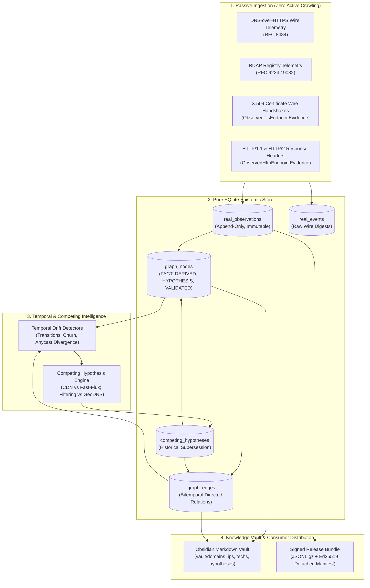

# ANIE — AI-Native Internet Intelligence Engine

**Phase 3.8 Multi-Vector Intelligence Engine • Evidence-First • Offline-First • Pure SQLite Graph • Detached Cryptographic Attestation**

ANIE is an independent, open-source-oriented internet intelligence engine that transforms empirical network observations into **evidence-linked, bitemporal, machine-readable intelligence graph records**. It is designed to provide verifiable infrastructure telemetry and competing analytical hypotheses to downstream security platforms (such as AEGIS) without requiring access to private case data, credentials, customer telemetry, or browser history.

---

## What Works Today (Milestone M3.8 Baseline)

### 1. Multi-Vector Passive Telemetry Normalization
- **DNS Telemetry:** RFC 8484 DNS-over-HTTPS (DoH) wire captures across multi-resolver vantage points (Cloudflare, Google, Quad9); validates complete answer sets, DNSSEC statuses (`secure`, `insecure`, `indeterminate`), response authenticity, and SHA-256 wire digests.
- **RDAP Discovery & Attribution:** RFC 9224 / RFC 9082 compliant service discovery and deterministic longest-prefix matching for Autonomous Systems (`ANNOUNCED_BY`) and BGP prefixes (`PREFIX_MEMBER`) with epistemic abstention against synthetic ASN attribution.
- **Passive TLS & X.509 Correlation:** Pure offline X.509 DER/PEM certificate parser; cryptographically binds `SERVES_CERTIFICATE` FACT edges strictly to verified live wire connection evidence (`ObservedTlsEndpointEvidence`), maps Subject Alternative Names (`NAMES_DOMAIN`), and enforces multi-tenant CDN/PaaS guardrails.
- **Passive HTTP Metadata Normalization:** Bounded parser for HTTP/1.1 and HTTP/2 wire responses (`http_enrichment.py`). Extracts `status_code`, `server`, `via`, `content_type`, HSTS, and CSP. Strictly strips cookies, auth tokens, URL query parameters, and response bodies (0 bytes retained). Enforces bounded limits ($\le 64$ headers, $\le 1024$ bytes/val, $\le 16\text{ KiB}$ aggregate header block). Classifies technologies strictly as Layer 2 `DERIVED` / spoofable assertions.

### 2. Graph-Native Property Graph & 4-Layer Epistemic Model
- **Pure SQLite Architecture:** Zero daemon or external binary dependencies; sub-millisecond $k$-hop recursive neighborhood traversals via composite bitemporal indexes.
- **4-Layer Epistemic Hierarchy:**
  - `FACT`: Immutable empirical wire transport captures (`ip`, `domain`, `resolver`, `certificate`).
  - `DERIVED`: Deterministic structural relationships computed via versioned rulesets (`RESOLVES_TO`, `ANNOUNCED_BY`, `PREFIX_MEMBER`, `NAMES_DOMAIN`, `USES_TECHNOLOGY`, `PROTECTED_BY_POLICY`).
  - `HYPOTHESIS`: Probabilistic inferences, anomaly indicators, and alternative explanations (`competing_hypotheses`, `intelligence_claims`).
  - `VALIDATED`: Cryptographically attested or analyst-verified assertions.

### 3. Competing Hypothesis Engine (`temporal_intelligence.py`)
- **Simultaneous Alternative Explanations:** Evaluates competing hypotheses for the same observed phenomena:
  - *IP Volatility:* Legitimate CDN/Anycast Edge Pool Rotation vs. Suspicious Fast-Flux Candidate.
  - *Resolver Discrepancy:* Upstream Threat Policy Filtering vs. Regional GeoDNS Route Divergence.
- **Partitioned Evidence Tracking:** Explicitly tracks `supporting_evidence_hashes` and `contradicting_evidence_hashes` separately.
- **Epistemic Humility:** Employs explicit uncalibrated heuristic scores ($0.0\text{ to }1.0$) with `statistically_calibrated: false` to avoid confusing heuristic ratings with frequentist or Bayesian probabilities.
- **Epistemic Abstention:** Emits `INSUFFICIENT_EVIDENCE` status when observation epochs are sparse ($<2$ epochs).
- **Historical Supersession:** Revisions preserve prior hypotheses as `SUPERSEDED` with `valid_until = now_iso` in SQLite and links via `RelationType.SUPERSEDES`, maintaining an unbroken audit chain.

### 4. Plaintext Knowledge Vault Export (`graph_engine.py`)
- Generates fully portable Markdown notes compatible with Obsidian and standard PKMs:
  - `vault/domains/`: Domain infrastructure notes with direct relationships and inbound claims.
  - `vault/ips/`: IP endpoint notes with reverse DNS, ASN announcements, and BGP allocations.
  - `vault/asns/`: Regional Internet Registry allocations and announced IP pools.
  - `vault/prefixes/`: BGP CIDR network prefix notes.
  - `vault/certificates/`: X.509 certificate notes, validity windows, and serving endpoints.
  - `vault/claims/`: Epistemic intelligence claims and falsifiability conditions.
  - `vault/technologies/`: Technology indicators with associated domains, IPs, and spoofability warnings.
  - `vault/hypotheses/`: Competing hypotheses with supporting/contradicting evidence and supersession links.
- **Security & Containment:** Hardened against directory traversal, Windows device names (`CON`, `PRN`, `AUX`, `NUL`), symlinks, and a 500 KB note ceiling.

### 5. Detached Cryptographic Attestation & Four-Tier Verification
- **Air-Gapped Signing:** Collector instances produce unsigned candidate release bundles; Ed25519 signing keys reside strictly on air-gapped operator workstations (`real_publish.py`).
- **Four-Tier Verification:** Consumers verify structural syntax, raw evidence integrity (`raw_sha256`), publisher cryptographic signatures, and stateful anti-rollback monotonic sequences completely offline without calling home (`release_trust.py`).

### 6. Infrastructure & Autonomous Capacity Management
- **Quiescent Collector VM:** `anie-collector-01` (`129.225.109.227`, `VM.Standard.E2.1.Micro`) operating securely at ₹0.00 / $0.00 cost under strict systemd cgroup sandboxing (`MemoryMax=128M`, `CPUQuota=20%`).
- **Autonomous A1 Capacity Runner:** Unattended Windows Task Scheduler runner (`ANIE_Ampere_A1_Capacity_Retry`) with strict 60-minute rate governor attempting Always Free `VM.Standard.A1.Flex` capacity acquisition.

---

## Quick Start (Python 3.10+)

From the repository root with zero third-party requirements (core runs on standard library):

```bash
# Set PYTHONPATH to include source
export PYTHONPATH="src:."  # Linux/macOS
$env:PYTHONPATH="src;."   # Windows PowerShell

# Run the complete test suite (470 tests)
python -m unittest discover -s tests -v

# Run the repository governance and policy checker
python tools/check_repo.py

# Run the local demonstration
python -m anie demo --out ./local-data/demo
python -m anie verify --dir ./local-data/demo/publication
```

---

## Architecture Flow



---

## Repository Map

| Path | Purpose |
| :--- | :--- |
| `src/anie/observations.py` | Normalized point-in-time observation models and strict validation. |
| `src/anie/real_models.py` | First-party empirical models (`RealObservation`, `RealCollectionEvent`, `FactualVerification`). |
| `src/anie/real_store.py` | SQLite authoritative store with foreign key constraints and atomic bundling. |
| `src/anie/graph_models.py` | 4-layer epistemic hierarchy (`EpistemicLayer`, `GraphNode`, `GraphEdge`, `NodeType`, `RelationType`). |
| `src/anie/graph_engine.py` | Graph indexing, $k$-hop traversals, FTS5 search, and Obsidian vault markdown export. |
| `src/anie/temporal_intelligence.py` | Historical anomaly detectors and the Competing Hypothesis Engine. |
| `src/anie/rdap_enrichment.py` | RFC 9224 RDAP service discovery and BGP prefix / ASN correlation. |
| `src/anie/tls_enrichment.py` | Passive X.509 certificate parsing and verified TLS endpoint linking. |
| `src/anie/http_enrichment.py` | Bounded HTTP/1.1 and HTTP/2 response metadata normalization and technology extraction. |
| `src/anie/real_publish.py` | Deterministic dataset serialization, gzip archives, and detached Ed25519 signing. |
| `src/anie/release_trust.py` | Four-tier consumer release verification and anti-rollback sequence enforcement. |
| `src/anie/consumer_contract.py` | AEGIS-compatible consumer contract reader and release journal ingestion. |
| `src/anie/capacity_retry.py` | Autonomous Oracle Cloud Ampere A1 capacity acquisition engine. |
| `docs/` | Architectural specifications, ADRs, runbooks, and research plans. |
| `tests/` | Comprehensive test suite (40 modules, 470 tests). |

---

## Documentation Index

- [Documentation Master Index](docs/DOCUMENTATION_INDEX.md)
- [Architecture & Epistemic Boundaries](docs/ARCHITECTURE.md)
- [Phase 3 Architecture Revision](docs/PHASE3_ARCHITECTURE_REVISION.md)
- [Milestone M3.8 Specification](docs/ANIE_M3_8_SPECIFICATION.md)
- [ADR 004: Graph Knowledge Architecture](docs/ADR_004_GRAPH_KNOWLEDGE_ARCHITECTURE.md)
- [Agent & Contributor Operating Contract](AGENTS.md)
- [Development Workflow & Governance](docs/DEVELOPMENT_WORKFLOW.md)
- [Security Policy](SECURITY.md)
- [Changelog](CHANGELOG.md)

---

## License

ANIE is released under the [Apache License 2.0](LICENSE).
