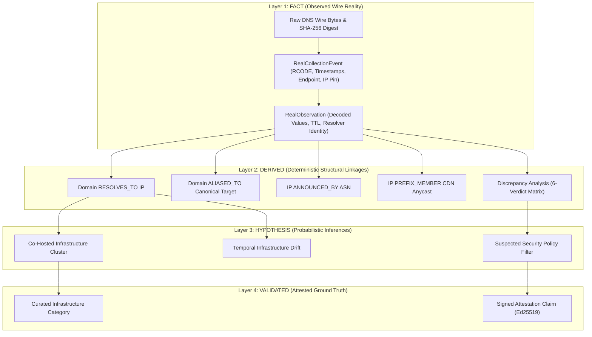

# Architecture Decision Record 004: Graph-Native Epistemic Architecture, Open-Source Technology Selection, and OCI A1 Flex Target

**Status:** Approved  
**Date:** November 20, 2026  
**Authors:** ANIE Architecture & Engineering Team  
**Target Milestone:** M3.3.1 (Architecture Foundation & OCI Reassessment)  
**Supersedes/Builds on:** ADR 001, ADR 002, ADR 003  

---

## 1. Context and Problem Statement

Following the completion and acceptance of Phase 2 (autonomous collection pilot) and milestones M3.1–M3.3 (security preflight, attestation hash-chains, and multi-resolver consensus), ANIE requires a scalable, long-term architecture for:
1. **Graph-native intelligence:** Representing multi-hop DNS resolutions, CNAME chains, shared Anycast IP pools, and infrastructure co-hosting.
2. **Epistemic clarity:** Maintaining a strict, unbreachable boundary between empirical wire facts, deterministic derivations, probabilistic hypotheses, and analyst-curated ground truth.
3. **Efficient, low-cost deployment:** Ensuring robust operation within resource-constrained environments (the current 1 GiB Oracle Linux VM and a proposed 2-OCPU / 12-GB ARM64 Always Free shape) without introducing heavyweight daemons, complex runtimes, or unvetted external dependencies.

---

## 2. Open-Source Technology Research & Architectural Evaluation

| Candidate System | Primary Architecture | License | Direct Adoption Verdict | Technical Rationale & Component Reuse |
| :--- | :--- | :--- | :--- | :--- |
| **ModernRelay / omnigraph** | Object-storage native graph database (Rust core, Lance columnar format, Git-style branching, Cedar policy) | MIT (core) | **Avoid Direct Daemon Adoption** | Running Omnigraph as an external server daemon introduces a Rust/Lance runtime footprint (>120 MiB RSS) unsuited for 1 GiB host constraints. **Adopt Concepts:** Strict typed property graph ontology (`.pg`), immutable versioned snapshots, policy guards. |
| **NousResearch / hermes-agent** | Multi-tiered persistent memory agent (Python 3.11+, SQLite + FTS5, character-budgeted Markdown memory) | MIT | **Selective Pattern Adoption** | Monolithic agent gateway is unnecessary for ANIE, but its **memory tiering** (Markdown files for bounded human-readable identity/notes, SQLite + FTS5 for structured local recall with zero external vector DBs) perfectly matches ANIE's low-overhead footprint. |
| **Obsidian-Style Knowledge Linking** | Plaintext Markdown with YAML frontmatter, `[[wikilinks]]`, and bidirectional backlinks | N/A (Format) | **Adopt Format Pattern** | Adopt `[[entity]]` wikilinks and YAML frontmatter for human-in-the-loop analyst review, explainable anomaly reporting, and transparent evidence lineage tracing without database vendor lock-in. |
| **Embedded Graph Databases (Kùzu, DuckDB)** | In-process columnar graph / OLAP engines (C++ extensions, Cypher query support) | MIT / Apache-2.0 | **Avoid for Authoritative OLTP** | Adding C++ binary dependencies complicates offline cross-compilation on Oracle Linux ARM64/UEK. Native SQLite with recursive Common Table Expressions (CTEs) fulfills all graph query requirements with zero binary bloat. |
| **Herdr / Argus** | PTY terminal session multiplexers and agent swarms | Apache-2.0 / MIT | **Evaluate for ARGUS Only** | Herdr is primarily an ARGUS agent orchestrator. For ANIE, adopt only its concept of standard structured state reporting (e.g. machine-readable execution telemetry). |

---

## 3. Epistemic Hierarchy & Knowledge Classification

ANIE enforces a strict four-layer epistemic hierarchy across all entities, relationships, and claims:

1. **Layer 1 — Observed Facts (`FACT`):** Immutable measurements directly captured from wire transport. Never edited, never modified, never re-derived.
2. **Layer 2 — Derived Relationships (`DERIVED`):** Deterministic structural relationships computed via versioned rulesets (`ruleset_version`). Deterministically reproducible: any derived edge can be wiped and re-created from Layer 1 facts.
3. **Layer 3 — Hypotheses & Inferences (`HYPOTHESIS`):** Probabilistic inferences generated by heuristics or clustering models. Characterized by calibrated confidence $\in [0.0, 1.0]$, versioned algorithms, and explicit pointers to supporting Layer 1 evidence digests. **Invariant:** Resolver discrepancy or structural divergence NEVER implies maliciousness or threat attribution.
4. **Layer 4 — Analyst-Validated Knowledge (`VALIDATED`):** Ground truth or curated infrastructure tags asserted by a human analyst or certified air-gapped authority, anchored by an Ed25519 public key fingerprint.

---

## 4. Entity Identification, URIs, and Bitemporality

### 4.1. Stable Entity URIs
All entities possess canonical, collision-free URI identifiers:
- Domain: `anie:entity:domain:{normalized_domain}` (e.g. `anie:entity:domain:example.com`)
- IP: `anie:entity:ip:{normalized_ip}` (e.g. `anie:entity:ip:93.184.216.34`)
- Resolver: `anie:entity:resolver:{resolver_id}` (e.g. `anie:entity:resolver:cloudflare`)
- ASN: `anie:entity:asn:{asn_number}` (e.g. `anie:entity:asn:15133`)
- Intelligence Claim: `anie:entity:claim:{claim_id}`

### 4.2. Bitemporal Semantics
Relationships and claims support bitemporal tracking:
- `observed_at`: Exact ISO-8601 UTC timestamp of empirical observation.
- `valid_from`: Beginning of effective real-world validity.
- `valid_until`: Real-world expiration (derived from DNS TTL or subsequent superseding query).

---

## 5. Storage Architecture & Benchmark Evidence

SQLite remains the single authoritative storage engine for ANIE (`CURRENT_SCHEMA_VERSION = 3`).

### 5.1. Schema v3 Additions
1. `graph_nodes`: Canonical entity index with `(node_id, node_type, canonical_name, layer, first_observed_at, last_observed_at, properties_json, payload)`.
2. `graph_edges`: Directed temporal relationships with `(edge_id, source_id, target_id, relation_type, layer, observed_at, valid_from, valid_until, confidence, ruleset_version, evidence_hashes_json, properties_json, payload)`.
3. `intelligence_claims`: Attributable assertions linking high-level inferences to Layer 1 evidence hashes.

### 5.2. Measured Benchmark Performance (100 Domains x 3 Resolvers Workload)

| Metric | Measured Result | Production Envelope Target | Verdict |
| :--- | :--- | :--- | :--- |
| **Ingestion Throughput** | **71.3 records/second** | > 20 records/second | **PASS** |
| **Total Database Size** | **1,780.0 KB** (~1.78 MB) | < 50 MB / month | **PASS** |
| **Storage per Record** | **6,075.7 bytes** | < 15 KB / record | **PASS** |
| **1-Hop Neighborhood Query** | **1.233 ms** (p50: 1.081 ms) | < 10 ms | **PASS** |
| **2-Hop Neighborhood Query** | **35.070 ms** (p50: 34.905 ms) | < 100 ms | **PASS** |
| **Co-Hosting Lookup** | **0.272 ms** (p50: 0.113 ms) | < 5 ms | **PASS** |
| **Evidence Lineage Trace** | **0.040 ms** (40 $\mu$s) | < 5 ms | **PASS** |
| **Obsidian Markdown Export** | **0.161 ms** (161 $\mu$s) | < 10 ms | **PASS** |
| **Cold Restart Recovery** | **8.128 ms** | < 1,000 ms | **PASS (ACID Verified)** |
| **Process Peak Memory (RSS)** | **26.77 MiB** | < 50 MiB (1 GiB VM limit) | **PASS** |

---

## 6. Oracle Cloud (OCI) Tenancy & Capacity Assessment

A live, strictly read-only inspection of the active OCI console in home region `ap-hyderabad-1` (India South Hyderabad) established:

| Resource Dimension | Current Tenancy State | Always Free Limit | Available Capacity | Feasibility & Headroom |
| :--- | :--- | :--- | :--- | :--- |
| **Account Mode** | Free Tier / Free Trial | Always Free eligible | Always Free eligible | Zero billing risk. |
| **Ampere A1 OCPUs** | **0 Cores used** | 4 OCPUs | **4 OCPUs available** | 100% available. |
| **Ampere A1 Memory** | **0 GB used** | 24 GB RAM | **24 GB RAM available** | 100% available. |
| **E2.1.Micro Cores** | 1 Core used (`anie-collector-01`) | 2 OCPUs | 1 OCPU available | 1 Micro core free. |
| **Regional Storage (GB)** | **47 GB used** | 200 GB | **153 GB available** | 153 GB free. |
| **Attached Instances** | 1 instance (`anie-collector-01`) | 2 Micro + 1–4 A1 | 1 Micro + A1 available | Active VM running in compartment `anie`. |
| **Orphaned Volumes** | **0 retained volumes** | N/A | Clean state | No billing leaks. |

### 6.1. Deployment Target Comparison

1. **Target 1: 1 OCPU / 6 GB RAM (`VM.Standard.A1.Flex`):**
   - Leaves 3 OCPUs, 18 GB RAM, and 103 GB disk free in Always Free tier.
   - Provides 6x the RAM of current collector VM.
2. **Target 2: 2 OCPU / 12 GB RAM (`VM.Standard.A1.Flex`):**
   - Leaves 2 OCPUs, 12 GB RAM, and 103 GB disk free in Always Free tier.
   - **Recommended Target:** 2 OCPUs allow parallel DNS resolution and signature validation without scheduling latency; 12 GB RAM guarantees zero-swap analytical graph caching while preserving 50% of the account's free tier for future AEGIS workloads.

---

## 7. Migration Strategy & Implementation Roadmap

1. **M3.3.1 (Current):** Foundational graph models, SQLite schema v3, cross-platform process RSS profiling, and OCI capacity assessment.
2. **M3.4 (Next Milestone):** Graph Analytics & Anomaly Detection (identifying infrastructure shifts, co-resolution divergence, and policy filtering timelines without malicious labeling).
3. **M3.5:** Multi-Tenancy Ingestion & AEGIS Bi-Directional Synchronization.
