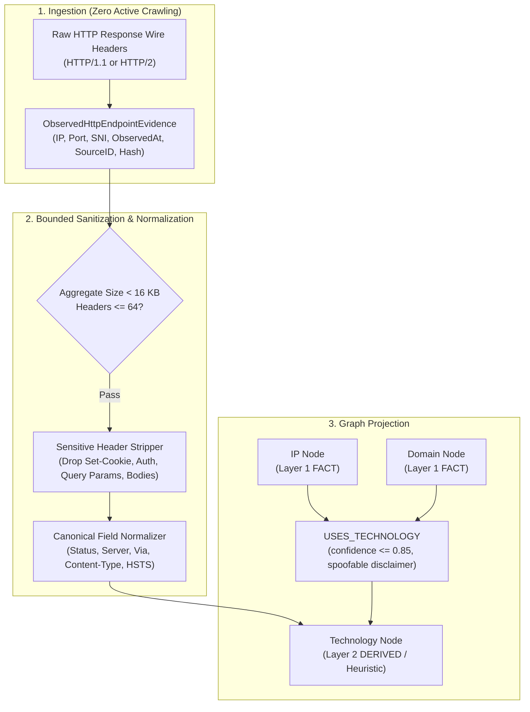
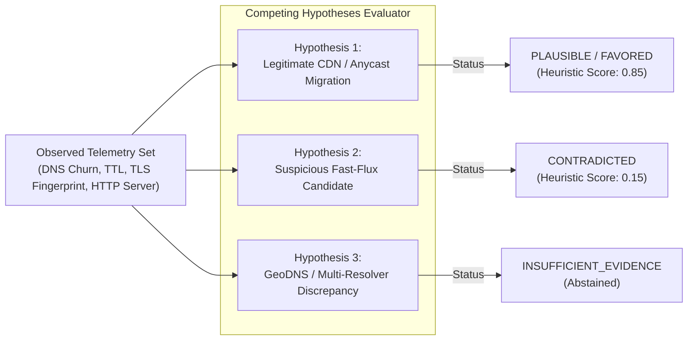

# ANIE — Milestone M3.8 Specification & Technical Design

**Milestone:** M3.8 — Multi-Vector Intelligence, Passive HTTP Metadata & Competing Hypotheses  
**Engineering Owner:** Antigravity (Anti)  
**Baseline Git Commit:** `9b3e30d`  
**Status:** In Progress (Spec-Driven Development)  

---

## 1. Executive Summary & Objective

Milestone M3.8 expands the ANIE First-Party Intelligence Engine into multi-vector passive telemetry and structured competing hypotheses, without breaking resource budgets, security invariants, or epistemic boundaries:

1. **Workstream A — Passive HTTP Intelligence (`src/anie/http_enrichment.py`):**
   - Ingests bounded, provenance-bearing HTTP/1.1 and HTTP/2 response metadata.
   - Extracts and canonicalizes approved fields: `status_code`, `server`, `via`, `content_type`, HSTS (`strict_transport_security`), CSP presence, and derived technology indicators.
   - Strictly strips bodies, cookies, authentication tokens, query strings, and sensitive headers.
   - Enforces strict parsing complexity and size ceilings (<16 KB aggregate, <1024 bytes per field, $\le 64$ headers).
   - Classifies technology indicators strictly as **spoofable, derived assertions** (`DERIVED`), never verified wire facts (`FACT`).

2. **Workstream B — Competing Hypothesis Engine (`src/anie/temporal_intelligence.py`):**
   - Evaluates observations against multiple alternative explanations simultaneously (e.g. Legitimate CDN/Anycast migration vs. Suspicious fast-flux candidate vs. GeoDNS resolver filtering).
   - Partitions supporting and contradicting evidence independently.
   - Formalizes explicit falsifiability conditions and epistemic abstention (`INSUFFICIENT_EVIDENCE`).
   - Distinguishes uncalibrated heuristic scores from calibrated probabilities.
   - Preserves historical hypotheses and revision chains through supersession linkages (`SUPERSEDES`).

3. **Workstream C — Graph Models and Knowledge Export (`src/anie/graph_models.py`, `src/anie/graph_engine.py`):**
   - Introduces typed entity nodes: `NodeType.TECHNOLOGY`, `NodeType.HYPOTHESIS`.
   - Introduces typed directed edges: `RelationType.USES_TECHNOLOGY`, `RelationType.PROTECTED_BY_POLICY`, `RelationType.EXPLAINS`, `RelationType.CONTRADICTS`, `RelationType.SUPERSEDES`.
   - Projects deterministic graph representations into Obsidian-compatible vault notes under `vault/technologies/` and `vault/hypotheses/`.
   - Enforces path traversal protection, Windows reserved filename sanitization, 500 KB note ceilings, and symlink rejection.

4. **Workstream D — Verification & Operational Bounds:**
   - Exhaustive unit test coverage for malformed HTTP headers, sensitive header leakage, forged evidence references, conflicting hypotheses, graph rebuild determinism, and vault export safety.
   - Peak RSS $<50\text{ MiB}$, single-hop query $<10\text{ ms}$, pure SQLite ACID storage, zero daemon dependencies.

---

## 2. Technical Architecture & Data Models

### 2.1 Provenance-Bearing Passive HTTP Telemetry



#### Class: `ObservedHttpEndpointEvidence`
```python
@dataclass(frozen=True)
class ObservedHttpEndpointEvidence:
    ip: str
    port: int
    sni_or_host: str
    observed_at: str
    source_id: str
    evidence_hash: str
    http_version: str = "HTTP/1.1"  # "HTTP/1.1" or "HTTP/2"
```

#### Class: `HttpResponseRecord`
```python
@dataclass(frozen=True)
class HttpResponseRecord:
    status_code: int
    canonical_headers: tuple[tuple[str, str], ...]
    server: str | None
    via: str | None
    content_type: str | None
    hsts_header: str | None
    hsts_max_age: int | None
    hsts_include_subdomains: bool
    csp_present: bool
    technology_indicators: tuple[str, ...]
    raw_header_hash: str
```

### 2.2 Competing Hypothesis Architecture



#### Data Model: `CompetingHypothesis`
```python
@dataclass(frozen=True)
class CompetingHypothesis:
    hypothesis_id: str
    subject_uri: str
    phenomenon: str
    hypothesis_label: str
    status: str  # "FAVORED", "PLAUSIBLE", "CONTRADICTED", "INSUFFICIENT_EVIDENCE"
    heuristic_score: float  # Explicit uncalibrated score [0.0..1.0]
    statistically_calibrated: bool  # Strictly False for rule-based heuristics
    supporting_evidence_hashes: tuple[str, ...]
    contradicting_evidence_hashes: tuple[str, ...]
    falsifiability_condition: str
    ruleset_version: str
    asserted_at: str
    supersedes_hypothesis_id: str | None = None
    properties: dict[str, Any] = field(default_factory=dict)
```

---

## 3. Work Breakdown Structure & Tasks

| Task | Workstream | Description | Status |
| :--- | :--- | :--- | :--- |
| **T1** | Core Graph | Add `TECHNOLOGY` & `HYPOTHESIS` to `NodeType`; add `USES_TECHNOLOGY`, `PROTECTED_BY_POLICY`, `EXPLAINS`, `CONTRADICTS`, `SUPERSEDES` to `RelationType` in `graph_models.py`. | Pending |
| **T2** | HTTP Enrichment | Implement `src/anie/http_enrichment.py` with bounded parser, sensitive stripping, technology extraction, and graph mapping. | Pending |
| **T3** | Hypothesis Engine | Implement Competing Hypothesis evaluation in `src/anie/temporal_intelligence.py` with separate supporting/contradicting evidence tracking and abstention. | Pending |
| **T4** | Knowledge Export | Extend `GraphEngine` with `vault/technologies/` and `vault/hypotheses/` note generators, path traversal sanitization, and README index update. | Pending |
| **T5** | Test Suite | Author comprehensive unit and integration tests in `tests/test_http_enrichment.py` and `tests/test_competing_hypotheses.py`. | Pending |
| **T6** | Verification & PR | Execute full test suite, verify memory/latency budgets, create PR #36, verify CI matrix, and merge under governance. | Pending |

---

## 4. Acceptance Criteria

1. **Passive Telemetry:** No outbound HTTP requests or crawlers; strict parsing of HTTP/1.1 and HTTP/2 wire headers.
2. **Sensitive Data Protection:** Zero cookies, auth headers, query parameters, or body contents stored.
3. **Epistemic Integrity:** Derived technology assertions are classified as `DERIVED` or `HYPOTHESIS` with explicit spoofability warnings.
4. **Competing Hypotheses:** Evaluates alternative explanations with separate supporting and contradicting evidence sets; explicitly disclaims calibrated probability.
5. **Knowledge Vault:** Generates valid Obsidian markdown notes with bidirectional links and cross-platform sanitization.
6. **Performance & Memory:** Peak RSS $<50\text{ MiB}$ and query latency $<10\text{ ms}$ on 1 GiB single-core constraints.
7. **Governance:** Clean PR, 100% passing CI across Python 3.10, 3.12, 3.13, and squash-merge to `main`.
