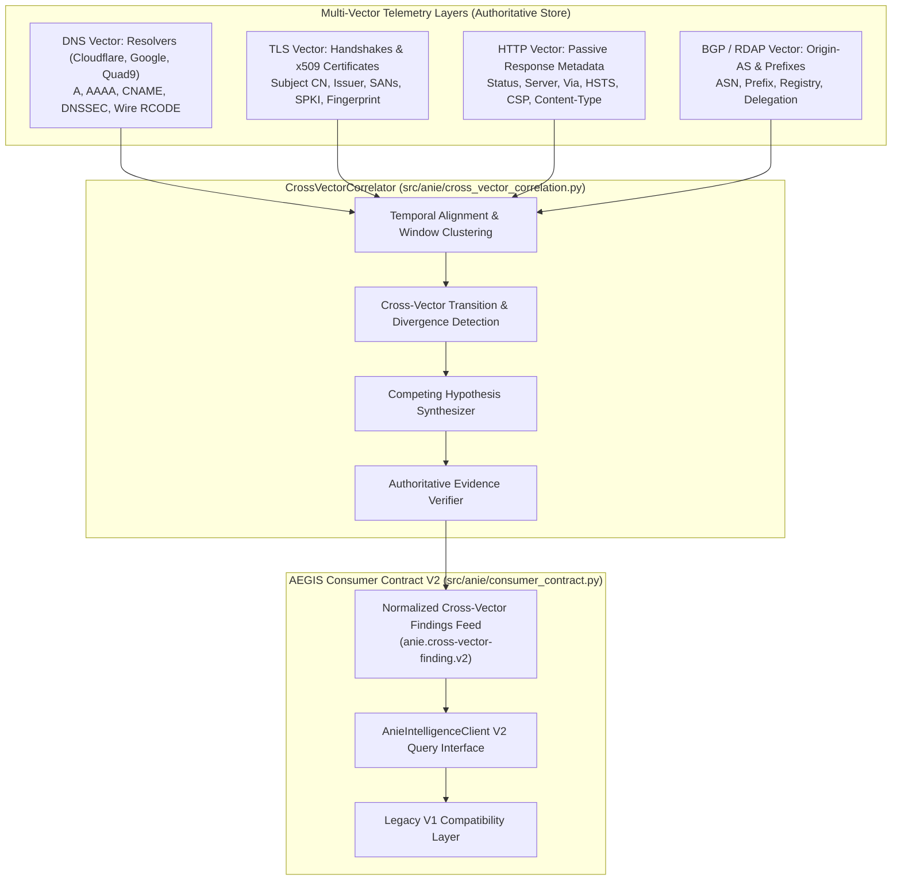

# ANIE Milestone M3.9 Specification: Cross-Vector Intelligence Correlation & AEGIS Consumer Integration

**Milestone:** M3.9 — Cross-Vector Intelligence Correlation & AEGIS Consumer Integration  
**Document:** `docs/ANIE_M3_9_SPECIFICATION.md`  
**Accepted Baseline:** Milestone M3.8 (`6352bc6`) / Modernized Docs (`2c0e773`)  
**Operating Standard:** Spec-Driven Development (SDD)  
**Security Standard:** Strict Authoritative Verification & Epistemic Humility  

---

## 1. Executive Summary & Objectives

Milestone M3.9 advances ANIE from multi-vector telemetry ingestion into **cross-vector intelligence correlation and consumer integration**. It unifies independently observed telemetry across Domain Name System (DNS), Transport Layer Security (TLS), Hypertext Transfer Protocol (HTTP), and Registration Data Access Protocol / Border Gateway Protocol (RDAP/BGP) into an explainable, uncertainty-aware intelligence stream for downstream consumers (including the AEGIS framework).

### Core Engineering Priorities:
1. **Bounded DNS + TLS + HTTP Cross-Vector Correlation:**
   - Detect and correlate infrastructure shifts occurring across multiple observation vectors.
   - Preserve precise source evidence references, observation timestamps, collection contexts, and explicit uncertainty for every vector.
2. **Temporal Correlation vs. Causation Separation:**
   - Explicitly recognize that co-occurrence in time does not imply causation or malice.
   - Formulate alternative, competing hypotheses for observed shifts (e.g. Legitimate CDN Migration, Routine Certificate Rotation, Shared Hosting / Multi-Tenant Rebalancing, and Multi-Vector Divergence / Misconfiguration).
   - Compute uncalibrated heuristic scores, falsifiability conditions, and explicit corroborating vs. contradicting evidence sets.
3. **AEGIS Consumer Contract V2 & Compatibility:**
   - Develop Consumer Contract V2 (`anie.consumer-contract.v2`) with normalized cross-vector findings feeds and cursor pagination.
   - Maintain 100% backward compatibility for existing V1 consumers (`anie.consumer-contract.v1`, `anie.canonical-ioc-feed.v1`, `anie.entity-provenance-bundle.v1`).
4. **Authoritative Evidence Resolution:**
   - Enforce that every evidence reference in findings, claims, or queries must resolve to a verifiable authoritative record in the observation store.
   - Prohibit authenticating an observation based solely on a user-supplied hash.
5. **Policy-Controlled Retention Lifecycle:**
   - Authoritative observations, raw events, cryptographic signatures, and audit journals are **never destructively pruned by default** (`allow_destructive_pruning=False`).
   - Derived graph indexes and correlation caches may be compacted and rebuilt deterministically from authoritative records.
   - If destructive pruning is explicitly authorized, an immutable cryptographic tombstone ledger is maintained.
6. **Deterministic Replay & Resource Sustainability:**
   - Bounded memory ($<200\text{ MiB}$ peak RSS) and sub-quadratic query execution.
   - Robustness against out-of-order observations, duplicate events, and malformed inputs.
   - Complete independence from AEGIS and the private Proof-Native Storage research project.

---

## 2. Cross-Vector Correlation Architecture



---

## 3. Epistemic Competing Hypotheses for Infrastructure Shifts

When a domain or IP undergoes an observable transition across one or more vectors, the engine synthesizes competing explanations rather than asserting a singular threat verdict:

| Phenomenon | Competing Hypothesis Label | Corroborating Signals | Contradicting Signals | Default Epistemic Status |
| :--- | :--- | :--- | :--- | :---: |
| **Multi-Vector Infrastructure Shift** | **Legitimate CDN / Cloud Migration** | DNS IP shifts to known CDN prefix; TLS cert rotates to CDN-managed CA (e.g. Cloudflare, Let's Encrypt); HTTP `Server`/`Via` matches CDN proxy headers. | IP belongs to non-CDN residential/bulletproof range; TLS cert is self-signed or invalid; HTTP `Server` contradicts CDN. | `FAVORED` (if CDN ranges match) |
| **Multi-Vector Infrastructure Shift** | **Routine Certificate Renewal** | DNS IP and HTTP `Server` remain identical; TLS cert fingerprint changes, but Subject CN and SANs match previous cert exactly within renewal window ($\le 30$ days to expiry). | DNS IP changed simultaneously; Subject CN or SANs stripped or altered. | `FAVORED` (if DNS/HTTP unchanged) |
| **Multi-Vector Infrastructure Shift** | **Shared Hosting / Multi-Tenant Rebalance** | DNS IP changes to another shared hosting provider; TLS cert indicates multi-tenant edge; HTTP server remains generic (e.g. `Apache`, `nginx`, `cPanel`). | Dedicated enterprise IP; single-tenant extended validation (EV) cert. | `PLAUSIBLE` |
| **Multi-Vector Infrastructure Shift** | **Multi-Vector Divergence / Anomaly** | DNS points to IP X, but TLS handshake at IP X does NOT contain domain in SANs; or HTTP returns 404 / misdirected request / unexpected technology. | TLS handshake succeeds with valid SAN; HTTP returns valid application response. | `PLAUSIBLE` / `CONTRADICTED` |

### Epistemic Heuristic Score Disclaimer
Every cross-vector finding and competing hypothesis carries an explicit disclaimer:
> *"Heuristic confidence scores are rule-based similarity and corroboration metrics, NOT calibrated frequentist or Bayesian probabilities. Empirical novelty and infrastructure drift do not constitute proof of maliciousness or compromise."*

---

## 4. Authoritative Evidence Verification Invariant

To prevent forged or hallucinated evidence from entering intelligence claims or consumer feeds:
1. **No Hash-Only Trust:** A user-supplied SHA-256 hash alone **never authenticates an observation**.
2. **Authoritative Store Resolution:** Every evidence hash must resolve to a valid, committed record in `real_events` or `real_observations`.
3. **Digest Integrity Check:** The retrieved record's `raw_sha256` or `wire_sha256` must cryptographically match the queried hash.
4. **Provenance Validation:** The record's `source_id` must originate from an authorized first-party collection vector (`first_party:doh:...`, `first_party:tls:...`, `first_party:http:...`).
5. **Failure Mode:** If an evidence reference cannot be resolved or verified in the authoritative store, the finding's verification status is marked `UNVERIFIED_EVIDENCE_REFERENCE`, and the reference is excluded from supporting evidence.

---

## 5. Policy-Controlled Retention Lifecycle

Retention in ANIE is designed around the principle of **evidence durability**:

1. **Authoritative Evidence Immutability:**
   - Authoritative tables (`real_events`, `real_observations`, `release_evidence_index`, `consumer_releases`) represent the historical empirical record.
   - By default, `allow_destructive_pruning = False`. Authoritative evidence is **never deleted by default**.
2. **Derived Graph Compaction & Rebuild:**
   - Derived property graph nodes (`graph_nodes`), relationship edges (`graph_edges`), and temporary hypothesis caches may be compacted or pruned to conserve storage.
   - Compaction must be 100% reversible: the function `rebuild_derived_indexes(store)` deterministically reconstructs all derived graph nodes and edges from authoritative records.
3. **Controlled Pruning with Cryptographic Tombstones:**
   - If destructive pruning is explicitly authorized by an operator (`allow_destructive_pruning = True` with valid authorization token):
     - Records referenced by active signed releases (`release_evidence_index`) remain unconditionally protected.
     - Pruned records are recorded in an append-only `retention_tombstone_ledger` containing the pruned record ID, original SHA-256 digest, deletion timestamp, operator identity, and policy justification, preserving auditability and Merkle/hash-chain consistency.

---

## 6. AEGIS Consumer Contract V2 Specification

### Version Identifiers:
- Contract Version: `anie.consumer-contract.v2`
- Cross-Vector Finding Schema: `anie.cross-vector-finding.v2`
- Legacy V1 Support: `anie.consumer-contract.v1` (100% backward compatible).

### Normalized Cross-Vector Finding Schema (`anie.cross-vector-finding.v2`):
```json
{
  "finding_id": "fnd_7a8f9b0c1d2e3f4a5b6c7d8e9f0a1b2c",
  "subject_uri": "anie:entity:domain:example.com",
  "finding_type": "CROSS_VECTOR_INFRASTRUCTURE_SHIFT",
  "epistemic_layer": "HYPOTHESIS",
  "asserted_at": "2026-11-21T00:00:00Z",
  "valid_from": "2026-11-21T00:00:00Z",
  "valid_until": null,
  "state": "ACTIVE",
  "supersedes_finding_id": null,
  "temporal_correlation_vs_causation": {
    "coincident_change_detected": true,
    "causation_inferred": false,
    "analysis": "DNS IP change coincided with TLS certificate rotation and HTTP Server header shift within an 8-hour window. Temporal coincidence does not establish causal dependency."
  },
  "abstention_state": {
    "abstained": false,
    "reason": null,
    "participating_vectors": ["dns", "tls", "http"]
  },
  "vectors": {
    "dns": {
      "observed_at": "2026-11-20T10:00:00Z",
      "values": ["104.16.132.229", "104.16.133.229"],
      "resolver": "cloudflare",
      "evidence_id": "event_1234...",
      "evidence_hash": "4ffd1e..."
    },
    "tls": {
      "observed_at": "2026-11-20T10:05:00Z",
      "subject_cn": "example.com",
      "issuer": "Cloudflare Inc ECC CA-3",
      "san_names": ["example.com", "*.example.com"],
      "cert_sha256": "abcdef...",
      "evidence_id": "event_5678...",
      "evidence_hash": "8acc5b..."
    },
    "http": {
      "observed_at": "2026-11-20T10:10:00Z",
      "status_code": 200,
      "server": "cloudflare",
      "via": null,
      "hsts_present": true,
      "evidence_id": "event_9012...",
      "evidence_hash": "ec5482..."
    }
  },
  "competing_hypotheses": [
    {
      "hypothesis_id": "hyp_...",
      "label": "Legitimate CDN / Cloud Migration",
      "status": "FAVORED",
      "heuristic_score": 0.92,
      "statistically_calibrated": false,
      "explanation": "DNS moved to Cloudflare Anycast range, TLS certificate issued by Cloudflare CA with matching SANs, and HTTP Server header indicates cloudflare.",
      "falsifiability_condition": "Falsified if authoritative DNS delegates to non-CDN origin or TLS handshake fails.",
      "supporting_evidence_hashes": ["4ffd1e...", "8acc5b...", "ec5482..."],
      "contradicting_evidence_hashes": []
    },
    {
      "hypothesis_id": "hyp_...",
      "label": "Multi-Vector Divergence / Inconsistency",
      "status": "CONTRADICTED",
      "heuristic_score": 0.08,
      "statistically_calibrated": false,
      "explanation": "All three vectors (DNS, TLS, HTTP) show consistent Cloudflare edge termination.",
      "falsifiability_condition": "Falsified if HTTP server or TLS certificate fails to match DNS destination.",
      "supporting_evidence_hashes": [],
      "contradicting_evidence_hashes": ["4ffd1e...", "8acc5b...", "ec5482..."]
    }
  ],
  "disclaimer": "Heuristic confidence scores are uncalibrated and require independent verification. Anomaly hypotheses do not infer maliciousness."
}
```

---

## 7. Verification & Acceptance Criteria

1. **Cross-Vector Correlation Logic:**
   - Correctly ingests DNS, TLS, and HTTP observations.
   - Detects transitions across single and multiple vectors.
   - Evaluates competing hypotheses (CDN migration, cert renewal, shared hosting, divergence).
   - Separates temporal coincidence from causal relationship.
   - Abstains when multi-vector coverage is insufficient ($<2$ vectors).
2. **Authoritative Evidence Resolution:**
   - Real observation records with matching hashes pass verification.
   - Unknown hashes or user-fabricated hashes fail verification with `UNVERIFIED_EVIDENCE_REFERENCE`.
3. **Retention & Rebuild:**
   - Default retention asserts `allow_destructive_pruning=False` and keeps authoritative records intact.
   - Compaction of derived graph nodes/edges reduces storage footprint.
   - `rebuild_derived_indexes(store)` reconstructs identical graph structures from authoritative data.
4. **Consumer Contract V2:**
   - `AnieIntelligenceClient` exposes `query_cross_vector_findings()` with cursor pagination.
   - Existing V1 methods (`query_entities`, `query_claims`, `query_relationships`, `get_entity_provenance`, `export_canonical_ioc_feed`) continue to pass all existing tests.
5. **Testing & Code Quality:**
   - All existing 470 unit and integration tests continue to pass.
   - New unit and integration test modules cover all M3.9 requirements.
   - `python tools/check_repo.py` passes 100%.
   - Peak RSS remains $<200\text{ MiB}$.
