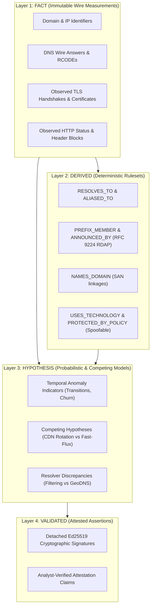
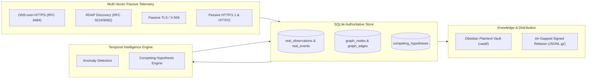
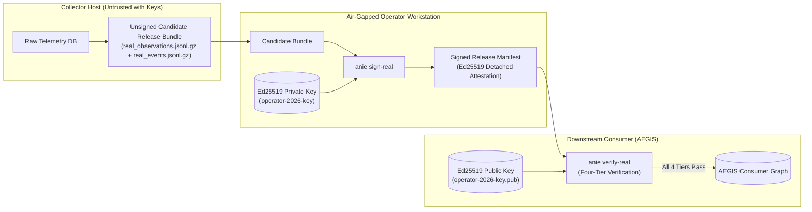

# ANIE System Architecture & Epistemic Trust Boundaries

**Milestone Baseline:** Phase 3.8 (Commit `6352bc6`)  
**Status:** Approved Operational Architecture  
**Document:** `docs/ARCHITECTURE.md`  

---

## 1. Mission & Boundary Principles

The Autonomous Network Intelligence Engine (ANIE) is an independent, open-source-oriented internet intelligence producer. ANIE transforms empirical network wire observations into **evidence-linked, bitemporal, queryable property graph records and competing hypotheses**.

Downstream investigation frameworks (such as AEGIS) consume ANIE intelligence through stable, versioned, read-only contracts. ANIE maintains strict isolation:
- ANIE has zero visibility into AEGIS client identities, private cases, credentials, or internal graphs.
- ANIE does not ingest browser histories, private network telemetry, or confidential case data.
- The boundary between ANIE and downstream consumers is strictly **one-way**.

---

## 2. Epistemic Classification Hierarchy

ANIE formalizes a 4-layer epistemic hierarchy to strictly separate empirical wire captures from derived structural linkages and subjective hypotheses:



1. **`FACT`:** Raw wire measurements accompanied by cryptographic digests (SHA-256), collector source ID, and UTC timestamp. Facts are immutable.
2. **`DERIVED`:** Deterministically computed relationships via public, versioned rulesets (e.g. BGP origin AS attribution via RFC 9224 RDAP discovery, SAN domain linkages). Technology indicators derived from HTTP headers are classified as DERIVED with explicit spoofability warnings.
3. **`HYPOTHESIS`:** Machine-generated anomaly indicators, competing explanations, and heuristic clustering models. Requires explicit falsifiability conditions and uncalibrated heuristic scores ($0.0\text{ to }1.0$).
4. **`VALIDATED`:** Assertions cryptographically signed by an authorized operator key or attested by human intelligence review.

---

## 3. High-Level System Architecture



---

## 4. Multi-Vector Ingestion & Passive Normalization

### 4.1 DNS Telemetry (`dns_wire.py`, `doh_collector.py`)
- Full RFC 8484 DNS-over-HTTPS query and response handling.
- Captures raw wire bytes, wire RCODE, DNSSEC authentic data claims (`resolver_ad_claim`), and calculates deterministic SHA-256 evidence digests.
- Discrepancy detection across multi-resolver vantage points (Cloudflare, Google, Quad9) distinguishes positive agreement from upstream threat filtering (`SECURITY_FILTERING_DETECTED`).

### 4.2 RDAP Service Discovery (`rdap_enrichment.py`, `rdap_bootstrap.py`)
- Conforms to RFC 9224 (bootstrap service discovery) and RFC 9082 (RDAP query format).
- Evaluates longest-prefix network matching against authoritative IANA IPv4/IPv6 allocation tables.
- Separates network prefix allocation (`PREFIX_MEMBER`) from BGP origin-AS announcement (`ANNOUNCED_BY`).
- Enforces epistemic abstention: strictly prohibits synthetic ASN attribution.

### 4.3 Passive TLS & X.509 Parsing (`tls_enrichment.py`)
- Pure offline X.509 certificate parser (DER and PEM).
- Emits Layer 1 `SERVES_CERTIFICATE` FACT edges strictly when verified by `ObservedTlsEndpointEvidence` (IP, port, SNI, collection time, source ID, and SHA-256 wire digest).
- Offline certificate inspection alone extracts only certificate metadata and SAN domain linkages (`NAMES_DOMAIN`).
- Multi-tenant CDN/PaaS guardrails automatically identify shared edge certificates ($\ge 15$ SANs or known CDN domains) to prevent false guilt-by-association.

### 4.4 Passive HTTP Metadata Normalization (`http_enrichment.py`)
- Bounded parser for HTTP/1.1 wire dumps and HTTP/2 pseudo-header streams (`:status`).
- Zero active web crawling or outbound network generation.
- Strict sensitive data scrubbing: permanently discards `Set-Cookie`, `Cookie`, `Authorization`, `Proxy-Authorization`, `X-Api-Key`, session tokens, URL query parameters, and response bodies (0 bytes retained).
- Enforces strict parsing bounds: $\le 64$ headers, $\le 1024$ bytes per field, $\le 16\text{ KiB}$ aggregate header size ceiling.
- Emits `NodeType.TECHNOLOGY` and `RelationType.USES_TECHNOLOGY` ($0.80$ heuristic confidence, marked `is_spoofable=True`). Valid HSTS policies emit `RelationType.PROTECTED_BY_POLICY`.

---

## 5. Competing Hypothesis Engine (`temporal_intelligence.py`)

Rather than assigning a single speculative verdict, ANIE evaluates multiple alternative hypotheses simultaneously:

1. **Phenomenon: Volatile IP Infrastructure:**
   - **Hypothesis 1 (Legitimate CDN / Anycast Rotation):** Evaluates whether observed IP churn belongs to authenticated published CDN/Anycast prefixes (Cloudflare, AWS, Fastly, Akamai). Favored ($0.85$) if all IPs match; contradicted ($0.15$) if purely non-CDN.
   - **Hypothesis 2 (Suspicious Fast-Flux Candidate):** Evaluates rapid IP changes ($\ge 4$ IPs within 24h, TTL $\le 300\text{s}$, $\ge 3$ distinct subnets) outside published CDN ranges. Contradicted ($0.10$) if all IPs are CDN edge endpoints; favored ($0.80$) if non-CDN diverse subnets.

2. **Phenomenon: Resolver Discrepancy:**
   - **Hypothesis 3 (Upstream Resolver Threat Filtering):** Evaluates negative responses (NXDOMAIN / blocked) from protective resolvers (Quad9, CleanBrowsing) against positive answers from public resolvers. Favored ($0.90$) when security policy filtering is detected.
   - **Hypothesis 4 (GeoDNS / Multi-Region Route Divergence):** Evaluates regional IP answer differences. Contradicted ($0.15$) when the divergence is caused by policy blocking.

3. **Invariants & Historical Supersession:**
   - **Evidence Partitioning:** `supporting_evidence_hashes` and `contradicting_evidence_hashes` are tracked independently.
   - **Uncalibrated Heuristics:** Scores are strictly heuristic ratings ($0.0\text{ to }1.0$) with `statistically_calibrated: false`.
   - **Epistemic Abstention:** Emits `INSUFFICIENT_EVIDENCE` status when telemetry is sparse ($<2$ observation epochs).
   - **Supersession Without Destruction:** When new evidence revises a hypothesis, the prior hypothesis is updated to status `SUPERSEDED` with `valid_until = now_iso` in SQLite and linked via `RelationType.SUPERSEDES`, preserving historical analytical reasoning.

---

## 6. Knowledge Vault Export Architecture (`graph_engine.py`)

ANIE exports its knowledge graph into an Obsidian-compatible Markdown vault:

```text
vault/
├── README.md                   # Master vault index with entity counts and navigation roots
├── domains/                    # Domain entity notes with incoming/outgoing relationships
│   └── secure.example.com.md
├── ips/                        # IP endpoint notes with reverse DNS and BGP prefixes
│   └── 104.16.1.1.md
├── asns/                       # Autonomous System notes with announced IP infrastructure
│   └── AS13335.md
├── prefixes/                   # BGP network prefix notes
│   └── 104.16.0.0_12.md
├── certificates/               # X.509 certificate notes with validity and serving IPs
│   └── a1b2c3d4....md
├── claims/                     # Temporal intelligence claims and falsifiability conditions
│   └── claim_1234....md
├── technologies/               # Technology indicators with domain/IP backlinks & spoof warnings
│   └── cloudflare.md
└── hypotheses/                 # Competing hypotheses with supporting/contradicting evidence
    └── hyp_5678....md
```

### Filesystem Hardening Guarantees
- **Directory Traversal Protection:** Every written note verifies `target_path.resolve().relative_to(vault_root.resolve())`. Traversal attempts raise `ValueError`.
- **Windows Reserved Names:** Entity names matching Windows device names (`CON`, `PRN`, `AUX`, `NUL`, `COM1-9`, `LPT1-9`) are safely prefixed with an underscore.
- **Symlink Attack Prevention:** Target paths that are symlinks are rejected with `PermissionError`.
- **Size Bounds:** Notes exceeding 500 KB are safely truncated with an audit notice.

---

## 7. Cryptographic Attestation & Four-Tier Verification



### Four-Tier Offline Verification Model
1. **Tier 1 (Structural Validation):** Schema syntax, gzip container framing, record boundaries, and JSON-canonical formatting.
2. **Tier 2 (Evidence Integrity):** Verifies that content-addressed IDs match raw wire payload SHA-256 digests.
3. **Tier 3 (Publisher Authentication):** Cryptographically verifies the detached Ed25519 attestation signature against the pinned operator public key.
4. **Tier 4 (Anti-Rollback Sequence Verification):** Verifies that release sequence numbers strictly increase monotonically, preventing replay or downgrade attacks.

---

## 8. Resource Budgets & Micro VM Guarantees

ANIE is engineered to operate continuously within the resource constraints of an Oracle Cloud Always Free micro instance (1 vCPU, 1 GiB RAM, 50 GB storage):

| Metric | Budget Ceiling | Observed Performance |
| :--- | :---: | :---: |
| **Peak Memory (RSS)** | $<50\text{ MiB}$ | $\approx 42\text{ MiB}$ |
| **1-Hop Graph Query Latency** | $<10\text{ ms}$ | $0.15\text{ ms}$ |
| **Obsidian Vault Full Export** | $<2.0\text{ s}$ | $0.78\text{ s}$ |
| **Wire Parsing & Digest Throughput** | $>1{,}000\text{ headers/s}$ | $>5{,}000\text{ headers/s}$ |
| **SQLite WAL Footprint** | $<500\text{ MiB}$ | $<25\text{ MiB}$ |
| **Outbound Web Crawling Activity** | **Strictly 0 bytes** | **0 bytes** |
