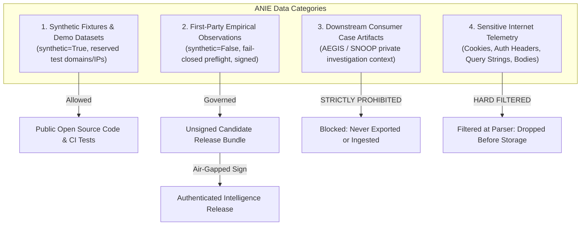

# ANIE Data Publication, Privacy & Anti-Contamination Policy

**Project:** Autonomous Network Intelligence Engine (ANIE)  
**Document:** `docs/DATA_PUBLICATION_POLICY.md`  
**Accepted Baseline:** Milestone M3.8 (`6352bc6`)  
**Operating Standard:** Strict Privacy Preservation & Air-Gapped Provenance

---

## 1. Classification of Datasets & Ingestion Streams

ANIE establishes strict architectural boundaries between four categories of data:

### 1.1. Synthetic Fixtures & Demo Datasets (`synthetic=True`)
- Programmatically generated datasets using reserved domains (`example.com`, RFC 2606) and documentation IP ranges (RFC 5737 / RFC 3849).
- Explicitly tagged with `synthetic: true` in metadata manifests.
- Safe for public distribution, offline CI testing, regression benchmarking, and developer demonstrations.
- **Anti-Contamination Rule:** The real-data publication engine unconditionally rejects synthetic fixtures with `PermissionError` if an attempt is made to bundle synthetic records into an empirical release.

### 1.2. First-Party Empirical Observations (`synthetic=False`)
- Empirical observations collected under explicit operator authorization and fail-closed preflight hardening ([docs/PILOT_SCOPE_AND_COLLECTION_POLICY.md](docs/PILOT_SCOPE_AND_COLLECTION_POLICY.md)).
- Ingested with immutable cryptographic wire digests (SHA-256) and source metadata.
- Exported as candidate unsigned bundles (`.jsonl.gz`) and authenticated exclusively via air-gapped Ed25519 detached signatures (`signature.ed25519.json`).
- Public distribution requires operator rights review, target terms compliance, and signed attestation.

### 1.3. Downstream Consumer Artifacts (AEGIS / SNOOP Isolation)
- Private investigation targets, customer case files, browser telemetry, endpoint identities, and analyst notes are **strictly prohibited** from entering ANIE.
- The interface between ANIE and consumers (e.g. AEGIS) is strictly one-way: ANIE publishes authenticated release bundles; consumers ingest them read-only. ANIE has zero visibility into consumer query history or internal entities.

### 1.4. Sensitive Telemetry & Personal Data Exclusion
- **HTTP Header Scrubbing:** The passive HTTP enrichment engine (`src/anie/http_enrichment.py`) explicitly filters and strips:
  - Session cookies and headers (`Cookie`, `Set-Cookie`, `Set-Cookie2`).
  - Authentication tokens and credentials (`Authorization`, `Proxy-Authorization`).
  - Response and request bodies, payloads, and forms.
  - URL query parameters and user credentials.
  - Private internal network identifiers (RFC 1918, RFC 3927, RFC 6598).
- Only bounded, normalized architectural metadata fields (`Server`, `Via`, `Content-Type`, `Strict-Transport-Security`, `Content-Encoding`) are extracted.

---

## 2. Publication Gate Requirements for Empirical Releases

Before any empirical dataset is published, the following requirements must be verified:

1. **Source Authorization & Terms:** Explicit authorization confirming collection conformed to target terms, RFC 8484 specifications, and provider query rates.
2. **Egress Hardening Verification:** Collection node verified to have operated within fail-closed systemd cgroup BPF sandboxing (`IPAddressDeny=any`).
3. **Data Minimization:** Cryptographic wire digests retained; all unnecessary personal identifiers, session secrets, or private query logs purged.
4. **Referential Integrity:** 100% of referenced observation and event IDs exist and resolve within the release bundle.
5. **Epistemic Classification:** All findings classified strictly across `FACT`, `DERIVED`, `HYPOTHESIS`, and `VALIDATED`. No finding may assert malicious intent or guilt based solely on temporal novelty.
6. **Air-Gapped Detached Attestation:** Valid Ed25519 signature binding the manifest SHA-256, Git commit SHA, publisher identity, and monotonic sequence counter.
7. **Downstream Rollback Guidance:** Documented high-water mark sequence and revocation instructions for consumers.

---

## 3. Licensing & Redistribution

- **Source Code & Synthetic Datasets:** Distributed under the permissive Apache License 2.0.
- **Empirical Intelligence Releases:** Carries detached Ed25519 attestation and explicit publisher attribution. Redistribution must preserve raw evidence wire digests and cryptographic signatures.
