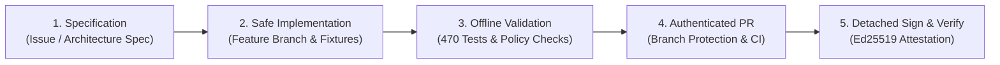

# ANIE Development Workflow — Phase 3 Specification

**Project:** Autonomous Network Intelligence Engine (ANIE)  
**Document:** `docs/DEVELOPMENT_WORKFLOW.md`  
**Accepted Baseline:** Milestone M3.8 (`6352bc6`)  
**Operating Standard:** Spec-Driven Development (SDD) & Strict Repository Governance

---

## 1. Architectural Boundaries & Non-Negotiables

ANIE is a public, independent first-party internet intelligence **producer**, not an AEGIS plugin or internal agent component.
- **Producer-Consumer Isolation:** ANIE publishes machine-consumable, evidence-backed, cryptographically signed observation releases. Downstream systems (e.g. AEGIS) consume these releases read-only.
- **Zero Context Exfiltration:** ANIE has zero visibility into downstream investigation targets, customer case data, or private analyst notes.
- **Air-Gapped Private Keys:** Primary Ed25519 signing keys never reside on cloud collector nodes or CI runners. Only air-gapped operator workstations perform detached signing.
- **Zero-Cost Constraint:** All infrastructure operates strictly within Always Free cloud envelopes ($0.00 / ₹0.00 billing impact).

---

## 2. Spec-Driven Development Lifecycle

All engineering work must proceed through five distinct phases:



### Step 1: Triage and Specification
Start with an authorized milestone specification or GitHub issue containing:
- Specific research/engineering objective and non-goals.
- Threat model, privacy impact, and data classification.
- Schema modifications and backward compatibility guarantees.
- Resource budgets (RAM $<200\text{ MiB}$, storage $<500\text{ MiB}$, CPU $<1\text{ OCPU}$).
- Concrete acceptance criteria and verification commands.

Risk Classification:
- **Low:** Offline algorithms, documentation, test fixtures, or utility tools without schema changes.
- **Medium:** Schema modifications, epistemic graph models, property serialization, or downstream consumer contract updates.
- **High:** Egress policy adjustments, cloud infrastructure interactions, capacity acquisition tooling, or cryptographic signing keys. Requires written authorization.

### Step 2: Safe Implementation
- Branch off the latest `main`: `git checkout -b <type>/<short-description>`.
- Never commit directly to `main` (branch protection enforces PR review and CI validation).
- Implement changes using the Python standard library wherever possible; avoid adding unvetted third-party dependencies.
- Ensure all observations, graph edges, and claims track complete provenance (`observed_at`, `evidence_hashes`, `vector`, `confidence`).
- Epistemic discipline: strictly classify knowledge as `FACT`, `DERIVED`, `HYPOTHESIS`, or `VALIDATED`. Never infer maliciousness from novelty.

### Step 3: Offline Validation
Execute the complete verification battery locally before pushing:

```powershell
# Set Python path to include both src and root
$env:PYTHONPATH="C:\Users\aniza\Downloads\anie\src;C:\Users\aniza\Downloads\anie"

# Run full unit and integration test suite (470 tests)
python -m unittest discover -s tests -v

# Run repository governance structural guardrails
python tools/check_repo.py

# Generate and verify synthetic intelligence publication
python -m anie demo --out ./local-data/development-demo
python -m anie verify --dir ./local-data/development-demo/publication
```

Bash equivalent:
```bash
export PYTHONPATH="src:."
python -m unittest discover -s tests -v
python tools/check_repo.py
python -m anie demo --out ./local-data/development-demo
python -m anie verify --dir ./local-data/development-demo/publication
```

### Step 4: Pull Request & CI Verification
- Push the feature branch to `origin`: `git push -u origin <branch-name>`.
- Open a Pull Request using GitHub CLI or web UI. When running in headless or agent environments, securely extract ambient Git credentials:
  ```powershell
  $cred = & { "protocol=https`nhost=github.com`n" | git credential fill }
  $env:GH_TOKEN = ($cred | Where-Object { $_ -match "^password=" }) -replace "^password=",""
  gh pr create --title "..." --body "..."
  ```
- Verify all required status checks pass in GitHub Actions:
  - `offline-python-3.10`
  - `offline-python-3.12`
  - `offline-python-3.13`
- Squash-merge into `main` after checks pass: `gh pr merge <pr-number> --squash --delete-branch`.
- Synchronize local repository: `git checkout main; git pull origin main`.

### Step 5: Detached Release Signing & Verification
- For production releases, candidate bundles are exported without private keys:
  ```bash
  python -m anie.real_publish --db-path ./local-data/real_intelligence.sqlite --output-dir ./dist/candidate-release
  ```
- Detached Ed25519 signing is executed on an air-gapped workstation:
  ```bash
  python -m anie.signed_release sign \
      --manifest ./dist/candidate-release/manifest.json \
      --private-key /path/to/airgapped/operator-2026-key.pem \
      --key-id operator-2026-primary \
      --sequence 42 \
      --output ./dist/candidate-release/signature.ed25519.json
  ```
- Downstream consumers verify release integrity and publisher authenticity completely offline:
  ```bash
  python -m anie.signed_release verify \
      --release-dir ./dist/candidate-release \
      --trusted-keys ./config/trusted_keys.json \
      --state-file ./local-data/consumer_highwater.json
  ```

---

## 3. Mandatory Governance & GitHub Settings

The repository enforces the following settings under GitHub repository management:
1. **Branch Protection (`main`):**
   - Require a pull request before merging.
   - Require status checks to pass before merging (`offline-python-3.10`, `offline-python-3.12`, `offline-python-3.13`).
   - Prohibit force pushes and branch deletions.
2. **Workflow Security:**
   - Default `GITHUB_TOKEN` permissions restricted to `contents: read`.
   - All third-party GitHub Actions pinned to immutable 40-character commit SHAs.
   - Zero secrets exposed to public PR runs.
3. **Dependency Automation:**
   - Dependabot enabled for weekly vulnerability assessments and dependency updates.
   - Never auto-merge dependency updates without running offline regression tests.
