# ANIE Master Documentation Index & Knowledge Map

**Project:** Autonomous Network Intelligence Engine (ANIE)  
**Accepted Baseline:** Milestone M3.8 (`6352bc65e6a81a535fa1d1de60ef0de4f0074d59`)  
**Operating Standard:** Spec-Driven Development (SDD)  
**Licensing:** Apache 2.0 Open Source Core  

This document serves as the canonical navigational index and architectural catalog for all engineering specifications, security policies, operational runbooks, and research plans across the ANIE repository.

---

## 1. Core Architecture & Governance

The primary documents defining system architecture, engineering operating standards, and repository invariants:

| Document | Description | Scope / Status |
| :--- | :--- | :--- |
| [README.md](file:///c:/Users/aniza/Downloads/anie/README.md) | High-level project overview, multi-vector intelligence architecture, quick start commands, and pipeline map. | Active / Primary |
| [AGENTS.md](file:///c:/Users/aniza/Downloads/anie/AGENTS.md) | Mandatory invariants and behavioral operating instructions for AI assistants, Copilot specialists, and human engineers. | Active / Mandatory |
| [CHANGELOG.md](file:///c:/Users/aniza/Downloads/anie/CHANGELOG.md) | Complete chronological release history detailing Milestones M3.1 through M3.8, pull requests, features, and fixes. | Active / Complete |
| [CONTRIBUTING.md](file:///c:/Users/aniza/Downloads/anie/CONTRIBUTING.md) | Guidelines for proposing changes, running offline tests, generating synthetic demos, and preserving data safety. | Active / Standard |
| [SECURITY.md](file:///c:/Users/aniza/Downloads/anie/SECURITY.md) | Security vulnerability disclosure process, reporting channels, and threat boundaries. | Active / Mandatory |
| [docs/ARCHITECTURE.md](file:///c:/Users/aniza/Downloads/anie/docs/ARCHITECTURE.md) | Technical architecture: 4-layer epistemic hierarchy, property graph engine, multi-vector ingestion, and memory budgets. | Active / Primary |
| [docs/DEVELOPMENT_WORKFLOW.md](file:///c:/Users/aniza/Downloads/anie/docs/DEVELOPMENT_WORKFLOW.md) | Spec-Driven Development (SDD) process, feature branch PR workflow, CI validation, and credential management. | Active / Process |
| [docs/RESEARCH_PLAN.md](file:///c:/Users/aniza/Downloads/anie/docs/RESEARCH_PLAN.md) | Core research question, empirical evaluation methodology, completed Increments 1–3, and Increment 4 roadmap. | Active / Research |

---

## 2. Phase 3 Milestone Specifications

Detailed technical specifications authored for each staged Phase 3 milestone:

```mermaid
flowchart LR
    M31["M3.1: Security Preflight<br/>(PR #31)"] --> M32["M3.2: Air-Gap Attestation<br/>(PR #32)"]
    M32 --> M33["M3.3: Multi-Resolver<br/>(PR #33)"]
    M33 --> M34["M3.4: Temporal Graph<br/>(PR #34)"]
    M34 --> M35["M3.5/3.5.1: Claims Ingest<br/>(PR #35)"]
    M35 --> M36["M3.6: RDAP & BGP<br/>(PR #35)"]
    M36 --> M37["M3.7: TLS Graph<br/>(PR #36)"]
    M37 --> M38["M3.8: Passive HTTP<br/>(PR #36)"]
    M38 --> M39["M3.9: Cross-Vector & AEGIS<br/>(M3.9)"]
```

| Document | Milestone | Focus Areas | PR & Status |
| :--- | :---: | :--- | :---: |
| [docs/PHASE3_ARCHITECTURE_REVISION.md](file:///c:/Users/aniza/Downloads/anie/docs/PHASE3_ARCHITECTURE_REVISION.md) | M3.1–M3.9 | Phase 3 foundational revision, core tenets, roadmap table, and verification sign-off. | Master Spec |
| [docs/PHASE3_1_SECURITY_SPECIFICATION.md](file:///c:/Users/aniza/Downloads/anie/docs/PHASE3_1_SECURITY_SPECIFICATION.md) | M3.1 | Preflight egress hardening, tri-state socket probes (`BLOCKED`, `ALLOWED`, `UNVERIFIABLE`), and sentinel barriers. | PR #31 (Merged) |
| [docs/PHASE3_2_PROVENANCE_ATTESTATION_SPECIFICATION.md](file:///c:/Users/aniza/Downloads/anie/docs/PHASE3_2_PROVENANCE_ATTESTATION_SPECIFICATION.md) | M3.2 | Detached Ed25519 signing CLI, dual-key rotation policies, anti-rollback monotonic sequence counter. | PR #32 (Merged) |
| [docs/PHASE3_3_MULTI_RESOLVER_SPECIFICATION.md](file:///c:/Users/aniza/Downloads/anie/docs/PHASE3_3_MULTI_RESOLVER_SPECIFICATION.md) | M3.3 | Multi-resolver normalized ingestion (Cloudflare, Google, Quad9), raw wire digests, discrepancy evaluation. | PR #33 (Merged) |
| [docs/PHASE3_3_2_INTEGRITY_AND_READINESS_SPECIFICATION.md](file:///c:/Users/aniza/Downloads/anie/docs/PHASE3_3_2_INTEGRITY_AND_READINESS_SPECIFICATION.md) | M3.3.2 | Post-M3.3 operational readiness review, storage sustainability assertions, and collector quiescence. | PR #33 (Merged) |
| [docs/PHASE3_4_TEMPORAL_GRAPH_INTELLIGENCE_SPECIFICATION.md](file:///c:/Users/aniza/Downloads/anie/docs/PHASE3_4_TEMPORAL_GRAPH_INTELLIGENCE_SPECIFICATION.md) | M3.4 | SQLite property graph schema, 7 canonical entities, edge temporal intervals (`valid_from`, `valid_until`), kNN drift. | PR #34 (Merged) |
| [docs/PHASE3_4_1_INTELLIGENCE_INTEGRITY_SPECIFICATION.md](file:///c:/Users/aniza/Downloads/anie/docs/PHASE3_4_1_INTELLIGENCE_INTEGRITY_SPECIFICATION.md) | M3.4.1 | Epistemic classification review, multi-resolver quorum integrity, and non-parametric drift validation. | PR #34 (Merged) |
| [docs/PHASE3_5_PILOT_AND_CONSUMER_CONTRACT_SPECIFICATION.md](file:///c:/Users/aniza/Downloads/anie/docs/PHASE3_5_PILOT_AND_CONSUMER_CONTRACT_SPECIFICATION.md) | M3.5 | AEGIS Consumer Contract V4, atomic SQLite ingestion transactions, reversible claim assertions, release journaling. | PR #35 (Merged) |
| [docs/PHASE3_6_GRAPH_INTELLIGENCE_AND_OBSIDIAN_SPECIFICATION.md](file:///c:/Users/aniza/Downloads/anie/docs/PHASE3_6_GRAPH_INTELLIGENCE_AND_OBSIDIAN_SPECIFICATION.md) | M3.6 | RFC 9224/9082 RDAP bootstrap parsing, BGP origin-AS attribution, and CDN/Anycast false-positive controls. | PR #35 (Merged) |
| [docs/PHASE3_7_TLS_AND_MULTI_VECTOR_SPECIFICATION.md](file:///c:/Users/aniza/Downloads/anie/docs/PHASE3_7_TLS_AND_MULTI_VECTOR_SPECIFICATION.md) | M3.7 | TLS x509 SAN parsing, live `SERVES_CERTIFICATE` fact edges requiring handshake evidence, vault sanitization. | PR #36 (Merged) |
| [docs/ANIE_M3_8_SPECIFICATION.md](file:///c:/Users/aniza/Downloads/anie/docs/ANIE_M3_8_SPECIFICATION.md) | M3.8 | Bounded passive HTTP/1.1 and HTTP/2 metadata normalization, Competing Hypothesis Engine, and Obsidian export. | PR #36 (Merged) |
| [docs/ANIE_M3_9_SPECIFICATION.md](file:///c:/Users/aniza/Downloads/anie/docs/ANIE_M3_9_SPECIFICATION.md) | M3.9 | DNS + TLS + HTTP cross-vector correlation, non-destructive retention, and AEGIS consumer contract v2. | M3.9 (Feature Complete) |

---

## 3. Security, Provenance & Privacy Policies

Policies governing cryptographic release verification, data classification, and operational safety:

| Document | Description | Scope / Standards |
| :--- | :--- | :--- |
| [docs/THREAT_MODEL.md](file:///c:/Users/aniza/Downloads/anie/docs/THREAT_MODEL.md) | Threat model across 6 trust boundaries, analysis of SSRF, IMDS exfiltration, decompression bombs, and technology spoofing. | System-wide Security |
| [docs/DATA_PUBLICATION_POLICY.md](file:///c:/Users/aniza/Downloads/anie/docs/DATA_PUBLICATION_POLICY.md) | Anti-contamination rules, synthetic fixture isolation, HTTP header scrubbing, and privacy-preserving data bounds. | Data Governance |
| [docs/RELEASE_PROCESS.md](file:///c:/Users/aniza/Downloads/anie/docs/RELEASE_PROCESS.md) | Step-by-step 7-stage release checklist, versioning rules, air-gapped signing procedures, and downstream verification. | Release Operations |
| [docs/RELEASE_TRUST_DESIGN.md](file:///c:/Users/aniza/Downloads/anie/docs/RELEASE_TRUST_DESIGN.md) | Architectural trust design: 4-tier verification hierarchy, anti-rollback monotonic sequence tracking, and dual-key policies. | Cryptographic Trust |
| [docs/REAL_PUBLICATION_AND_SIGNING.md](file:///c:/Users/aniza/Downloads/anie/docs/REAL_PUBLICATION_AND_SIGNING.md) | Operational guide for exporting candidate bundles, detached signing with `anie.signed_release`, and verification. | Operator Runbook |
| [docs/PILOT_SCOPE_AND_COLLECTION_POLICY.md](file:///c:/Users/aniza/Downloads/anie/docs/PILOT_SCOPE_AND_COLLECTION_POLICY.md) | Policy governing empirical pilot collection: target allowlists, query ceilings, and calendar day quotas. | Collection Envelope |

---

## 4. Infrastructure & Operational Runbooks

Guides for deploying, configuring, and verifying cloud instances and capacity runners:

| Document | Description | Platform / Scope |
| :--- | :--- | :--- |
| [docs/OCI_DEPLOYMENT_RUNBOOK.md](file:///c:/Users/aniza/Downloads/anie/docs/OCI_DEPLOYMENT_RUNBOOK.md) | Production setup runbook for Oracle Cloud Always Free VM (`anie-collector-01`), systemd cgroup BPF sandboxing. | Cloud / Oracle Linux |
| [docs/ORACLE_DRY_RUN_RUNBOOK.md](file:///c:/Users/aniza/Downloads/anie/docs/ORACLE_DRY_RUN_RUNBOOK.md) | Pre-deployment verification runbook for unprivileged sandboxing, netfilter validation, and SQLite initialization. | Staging / Validation |
| [docs/ACQUISITION_V04.md](file:///c:/Users/aniza/Downloads/anie/docs/ACQUISITION_V04.md) | Historical v0.4 offline acquisition design basis and synthetic scheduler caching rules. | Historical Reference |
| [docs/COLLECTOR_V02.md](file:///c:/Users/aniza/Downloads/anie/docs/COLLECTOR_V02.md) | Historical v0.2 offline collector architecture and synthetic fixture parser foundation. | Historical Reference |
| [docs/REAL_WORLD_PILOT.md](file:///c:/Users/aniza/Downloads/anie/docs/REAL_WORLD_PILOT.md) | Historical v0.4.1 exact-scope manual DoH pilot specification for single-target RFC 8484 validation. | Historical Reference |
| [docs/TEMPORAL_BENCHMARK.md](file:///c:/Users/aniza/Downloads/anie/docs/TEMPORAL_BENCHMARK.md) | Synthetic time-split machine learning benchmark comparing kNN distance against deterministic rules. | Evaluation Baseline |

---

## 5. Architectural Decision Records (ADRs)

Formal architecture decision records capturing foundational technical decisions:

| ADR | Title | Decision Summary |
| :---: | :--- | :--- |
| [ADR-0001](file:///c:/Users/aniza/Downloads/anie/docs/adr/0001-repository-boundaries.md) | Repository Boundaries & Federation | Established ANIE as an independent, standalone intelligence producer, strictly separating public datasets from private AEGIS and SNOOP context. |
| [ADR-0004](file:///c:/Users/aniza/Downloads/anie/docs/ADR_004_GRAPH_KNOWLEDGE_ARCHITECTURE.md) | Graph Knowledge Architecture | Adopted an embedded SQLite property graph engine with 7 entity types, temporal valid intervals, and Markdown Obsidian vault export over heavy external graph databases. |

---

## 6. Schemas & Data Contracts

Authoritative JSON and wire schemas governing data exchange:

| Schema / Contract | Path / Identifier | Description |
| :--- | :--- | :--- |
| Intelligence Contract V1 | `schemas/intelligence-v1.schema.json` (`anie.intelligence.v1`) | Core JSON schema for deterministic findings, anomaly scores, and referenced observation IDs. |
| Detached Attestation V1 | `anie.attestation.v1` | Detached Ed25519 signature format (`signature.ed25519.json`) binding key ID, manifest SHA-256, Git commit, and sequence. |
| Consumer Claims Contract V4 | `anie.claims.v4` | Downstream claims schema for reversible, evidence-backed findings ingested into AEGIS. |
| Observation Record V1 | `anie.observations.v1` | Wire schema for first-party multi-vector observations, cryptographic digests, and source timestamps. |

---

## 7. Cross-Reference Navigation Matrix

| If You Need To... | Consult These Documents First |
| :--- | :--- |
| Understand how ANIE works and its core models | [README.md](file:///c:/Users/aniza/Downloads/anie/README.md) $\to$ [docs/ARCHITECTURE.md](file:///c:/Users/aniza/Downloads/anie/docs/ARCHITECTURE.md) |
| Write code, add tests, or submit a pull request | [AGENTS.md](file:///c:/Users/aniza/Downloads/anie/AGENTS.md) $\to$ [docs/DEVELOPMENT_WORKFLOW.md](file:///c:/Users/aniza/Downloads/anie/docs/DEVELOPMENT_WORKFLOW.md) |
| Understand epistemic knowledge classification | [docs/ARCHITECTURE.md](file:///c:/Users/aniza/Downloads/anie/docs/ARCHITECTURE.md) $\to$ [docs/ANIE_M3_8_SPECIFICATION.md](file:///c:/Users/aniza/Downloads/anie/docs/ANIE_M3_8_SPECIFICATION.md) |
| Export or inspect an Obsidian knowledge vault | [docs/ARCHITECTURE.md](file:///c:/Users/aniza/Downloads/anie/docs/ARCHITECTURE.md#5-obsidian-knowledge-vault-export) $\to$ [docs/PHASE3_6_GRAPH_INTELLIGENCE_AND_OBSIDIAN_SPECIFICATION.md](file:///c:/Users/aniza/Downloads/anie/docs/PHASE3_6_GRAPH_INTELLIGENCE_AND_OBSIDIAN_SPECIFICATION.md) |
| Sign or verify a production intelligence release | [docs/REAL_PUBLICATION_AND_SIGNING.md](file:///c:/Users/aniza/Downloads/anie/docs/REAL_PUBLICATION_AND_SIGNING.md) $\to$ [docs/RELEASE_PROCESS.md](file:///c:/Users/aniza/Downloads/anie/docs/RELEASE_PROCESS.md) |
| Verify security controls or threat boundaries | [docs/THREAT_MODEL.md](file:///c:/Users/aniza/Downloads/anie/docs/THREAT_MODEL.md) $\to$ [docs/DATA_PUBLICATION_POLICY.md](file:///c:/Users/aniza/Downloads/anie/docs/DATA_PUBLICATION_POLICY.md) |
| Integrate a downstream consumer (AEGIS) | [docs/RELEASE_TRUST_DESIGN.md](file:///c:/Users/aniza/Downloads/anie/docs/RELEASE_TRUST_DESIGN.md) $\to$ [docs/PHASE3_5_PILOT_AND_CONSUMER_CONTRACT_SPECIFICATION.md](file:///c:/Users/aniza/Downloads/anie/docs/PHASE3_5_PILOT_AND_CONSUMER_CONTRACT_SPECIFICATION.md) |
| Inspect or manage Oracle Cloud VM deployment | [docs/OCI_DEPLOYMENT_RUNBOOK.md](file:///c:/Users/aniza/Downloads/anie/docs/OCI_DEPLOYMENT_RUNBOOK.md) $\to$ [docs/PILOT_SCOPE_AND_COLLECTION_POLICY.md](file:///c:/Users/aniza/Downloads/anie/docs/PILOT_SCOPE_AND_COLLECTION_POLICY.md) |
