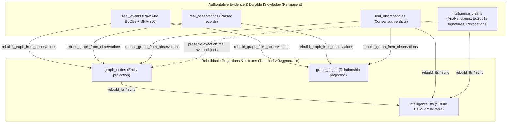
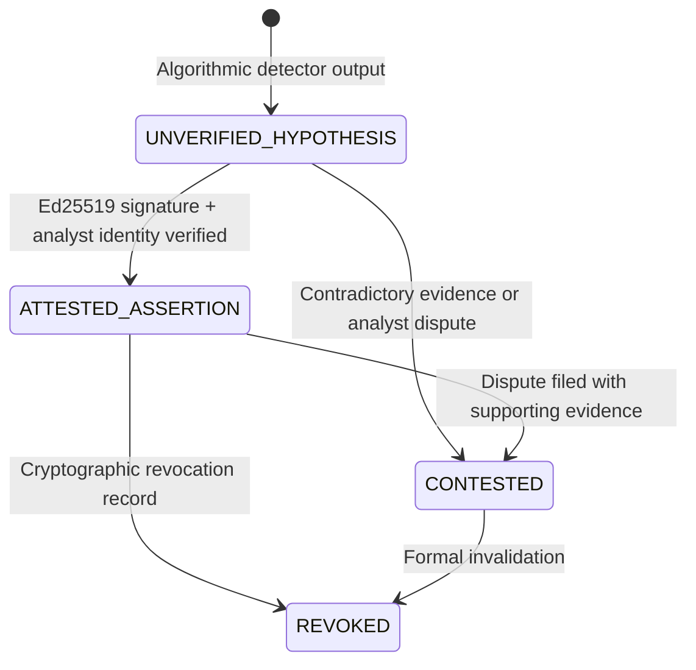

# Specification: M3.4.1 Intelligence Integrity & Scale Acceptance

**Status:** Approved Specification  
**Baseline Commit:** `a9fc1f08eb362624d1f43b6b201048905234cd11`  
**Author:** Antigravity (Anti)  
**Date:** November 20, 2026  
**Priority Hierarchy:** No data loss > Provenance correctness > Security > Temporal accuracy > Performance > Deployment readiness

---

## 1. Problem Statement & Mission Objectives

Milestone M3.4 introduced ANIE's temporal graph intelligence, SQLite FTS5 search, and 1-hop query optimization. A rigorous audit of M3.4 identified critical correctness defects:
1. **P0 Data Loss Risk in Graph Rebuilds:** `RealObservationStore.rebuild_graph_from_observations()` executed `DELETE FROM graph_nodes`, which cascaded via `ON DELETE CASCADE` into `intelligence_claims`. This risked permanently wiping out independently authored, analyst-validated, signed, or contested claims.
2. **P0 Epistemic Verification State Inflation:** Generated heuristic hypotheses in `TemporalIntelligenceEngine` were marked `ATTESTED_ASSERTION` without cryptographic signatures, and `IntelligenceClaim.from_dict()` promoted claims to `ATTESTED_ASSERTION` merely if any string was present in `attestation_signature`.
3. **P1 Temporal Correctness Gaps:**
   - Detectors queried `kind = 'dns_a'` only, completely ignoring IPv6 (`dns_aaaa`).
   - `as_of` historical filtering parameter was accepted but omitted from SQL `WHERE` clauses.
   - `_detect_fast_flux_indicators` lacked 24-hour window bounds on observation timestamps.
   - Observations across differing resolvers were aggregated without resolver-specific grouping in transition detection.
   - Static CDN prefixes conflated provider cloud ownership with verified Anycast edge behavior.
4. **P1 Graph Traversal Completeness:** Traversal lacked deterministic SQL ordering, failed to expose truncation/pagination metadata, and intermediate recursive CTE work was unbounded.
5. **P1 Search Integrity:** `sync_*_to_fts` swallowed exceptions with `except Exception: pass`, lacking failure visibility and reindex/repair tools.
6. **P1 Scale Acceptance & Projections:** Bounded synthetic benchmarks at 10,000 and 100,000 observations must be measured and reported without speculative ARM64 throughput claims.

---

## 2. Architectural Design & Boundaries



### 2.1 Storage Boundary Isolation (P0)
- `intelligence_claims` represents durable, non-reconstructible analyst knowledge, signed release attestations, and epistemic states (`UNVERIFIED_HYPOTHESIS`, `ATTESTED_ASSERTION`, `CONTESTED`, `REVOKED`).
- `graph_nodes` and `graph_edges` represent rebuildable graph projections derived from observations.
- **Rule:** Projection tables must NEVER have cascade deletion into durable knowledge tables.
- **Schema Migration:** Remove `REFERENCES graph_nodes(node_id) ON DELETE CASCADE` from `intelligence_claims(subject_uri)`.
- During `rebuild_graph_from_observations()`:
  - Do NOT touch rows in `intelligence_claims`.
  - Re-project graph nodes from observations and discrepancies.
  - Ensure all subject URIs referenced by preserved claims have corresponding projected entity nodes in `graph_nodes`.
  - Re-project all claims into `intelligence_fts`.

### 2.2 Epistemic State Machine & Attestation Engine (P0)



- **Invariants:**
  1. No algorithmic detector may output `ATTESTED_ASSERTION`. All automated outputs are strictly `UNVERIFIED_HYPOTHESIS`.
  2. Promotion to `ATTESTED_ASSERTION` requires:
     - `analyst_identity` is non-empty.
     - `attestation_signature` is non-empty.
     - Cryptographic Ed25519 verification succeeds against canonical claim bytes:
       `DOMAIN_SEPARATOR_CLAIM = b"ANIE-INTELLIGENCE-CLAIM-V1\x00"`
  3. `from_dict()` must not promote claims to `ATTESTED_ASSERTION` unless explicitly serialized as such AND verified. Unsigned claims default to `UNVERIFIED_HYPOTHESIS`.
  4. Heuristic confidence scores (e.g. 0.85) must be documented in claims as `heuristic_confidence` ratings, with explicit disclaimers against calibrated frequentist/Bayesian probabilities.

### 2.3 Temporal Correctness (P1)
- **Record Types:** Detectors must query both `dns_a` and `dns_aaaa` records to track dual-stack IPv4/IPv6 evolution.
- **`as_of` Filtering:** When `as_of` timestamp is specified, SQL queries must strictly filter `observed_at <= as_of` and `analyzed_at <= as_of`.
- **24-Hour Window:** `_detect_fast_flux_indicators` must restrict observation evaluation to `observed_at >= (as_of - 24 hours)`.
- **Resolver-Specific Grouping:** `_detect_infrastructure_transitions` must evaluate transitions per-resolver and across consensus epochs rather than conflating disparate resolver responses at a single timestamp.
- **CDN / Anycast Provenance:** Static prefixes are explicitly tagged with `source="iana_and_provider_published_ranges"` and `method="heuristic_prefix_match"`, avoiding authoritative BGP routing claims.

### 2.4 Graph Traversal Bounding & Determinism (P1)
- All incident and recursive queries must specify deterministic `ORDER BY`.
- Traversal results must return completeness metadata:
  ```json
  {
    "root_id": "...",
    "depth": 1,
    "truncated": false,
    "total_nodes_visited": 12,
    "total_edges_visited": 24,
    "max_depth_reached": 1,
    "nodes": [...],
    "edges": [...]
  }
  ```
- Intermediate work in recursive CTEs must be bounded to prevent exponential fan-out on resolver hubs or cyclic graphs.

### 2.5 Search Integrity (P1)
- Eliminate swallowed exceptions (`except Exception: pass`).
- Implement observable error recording in store (`fts_sync_errors: list[str]`).
- Add `reindex_fts()` and `verify_fts_integrity()` methods to deterministically detect and repair any search index divergence.

---

## 3. Scale Acceptance & OCI Readiness (P1)

- Measure empirical 10,000 and 100,000 synthetic observation workloads.
- Collect true measured metrics: p50/p95/p99 query latencies, ingestion throughput, RSS, DB/WAL sizes, and restart recovery.
- Prohibit speculative ARM64 throughput multipliers; label OCI target parameters strictly as target host hardware specifications.
- Maintain zero live queries and zero cloud infrastructure mutation.
