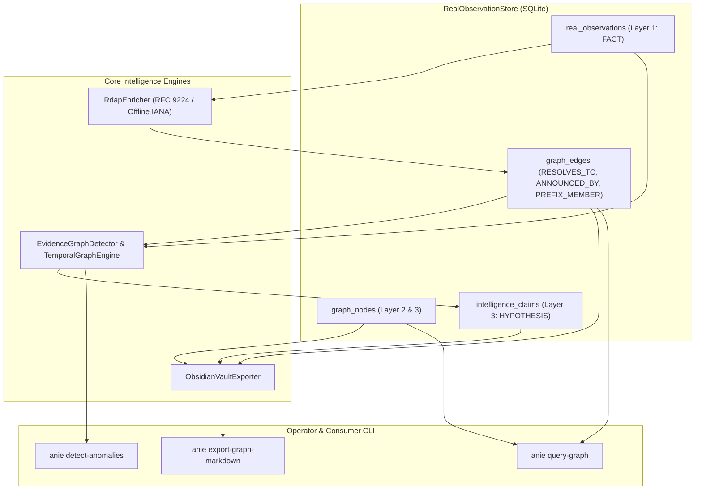

# ANIE — Milestone 3.6 Specification
## Autonomous Graph Intelligence, Explainable Obsidian Export & RDAP Infrastructure Correlation

- **Engineering Owner:** Antigravity (Anti)
- **Repository:** `pseudozac/anie`
- **Milestone:** M3.6
- **Status:** Approved for Implementation (Spec-Driven Development)
- **Baseline Commit:** `cdd615b`
- **Security Boundaries:** Fail-closed, zero unconstrained egress, zero host DNS resolution, zero cloud resource mutation, strict 1 GiB micro VM envelope.

---

## 1. Executive Summary & Problem Statement

Following the completion of M3.5/M3.5.1 (Consumer Contract, Signed Release V4, Retention) and the operational handover of the Always Free capacity acquisition runner, ANIE resumes its primary development roadmap.

While ANIE contains robust graph storage (`graph_nodes`, `graph_edges`), discrepancy engines, and temporal anomaly detectors (`TemporalGraphEngine`), three key functional capabilities remain incomplete for operational intelligence production:

1. **RDAP & ASN Infrastructure Context (Issue #12 & ADR 004):**
   DNS observations currently connect domains to IP addresses, but lack deterministic structural linkages to the underlying BGP Autonomous Systems (`ASN`) and allocation prefixes (`RDAP Network / CIDR`). An analyst observing `example.com -> 93.184.216.34` cannot query the hosting network entity (`AS15133`) or Anycast subnet without leaving the graph.
2. **Autonomous Anomaly Detection CLI Interface:**
   The temporal detection algorithms (`fast_flux_candidate`, `unexpected_resolution_change`, `shared_infrastructure_shift`, `resolver_discrepancy_timeline`) exist as library modules in `src/anie/temporal_intelligence.py`, but are not accessible via the operator CLI interface or automated batch workflows.
3. **Subgraph Exploration Interface:**
   Downstream operators and automated consumers require an efficient, bounded mechanism to query entity neighborhoods and directed paths without raw SQL manipulation.
4. **Explainable Obsidian-Style Knowledge Vault Export (ADR 004):**
   ADR 004 approved the adoption of Obsidian-style plaintext Markdown with YAML frontmatter, `[[wikilinks]]`, and bidirectional backlinks for transparent, vendor-agnostic analyst review. This capability has not yet been formalized as a core CLI command and export pipeline.

Milestone M3.6 implements these capabilities within ANIE's strict epistemic and resource constraints.

---

## 2. Open-Source Technology & Standards Alignment

| Component | Standard / Reference | License | Implementation Strategy |
| :--- | :--- | :--- | :--- |
| **RDAP IP Bootstrap** | RFC 9224 / RFC 9082 | IETF Standard | Reuse existing offline `OfflineRdapBootstrap` parser with preloaded canonical IANA registry fixtures. Zero live external HTTP/RDAP requests by default. |
| **Knowledge Linking** | Obsidian / CommonMark | Open Format | Plaintext Markdown with YAML frontmatter and `[[entity/id]]` wikilinks. Completely in-memory generation with zero external binary or database dependencies. |
| **Graph Traversal** | SQLite Recursive CTEs | Public Domain | Bounded depth-limited SQL traversals (<10 ms 1-hop, <50 ms 2-hop) with loop detection and node limits. |
| **Graph Ontologies** | ModernRelay / OmniGraph | MIT Pattern | Typed property graph entities and epistemic layering (FACT -> DERIVED -> HYPOTHESIS -> VALIDATED). |

---

## 3. Architecture & Functional Requirements

### Requirement 1: RDAP & ASN Infrastructure Correlation
- Extend `src/anie/canonical_entities.py` to recognize `asn:` (`anie:entity:asn:{asn}`) and `prefix:` (`anie:entity:prefix:{cidr}`) entity URIs.
- Implement `RdapEnricher` in `src/anie/rdap_enrichment.py`:
  - Enriches IP observations with deterministic Layer 2 `DERIVED` edges:
    - `IP -> ANNOUNCED_BY -> ASN`
    - `IP -> PREFIX_MEMBER -> Prefix`
  - Uses an offline, deterministic IANA IPv4/IPv6 prefix-to-ASN mapping fixture.
  - Fail-closed: Never issues outbound network connections during enrichment.
  - Synchronizes seamlessly into `graph_nodes` and `graph_edges` on observation insert or graph rebuild.

### Requirement 2: Autonomous Anomaly Detection CLI (`detect-anomalies`)
- Add CLI command `anie detect-anomalies`:
  - Flags: `--db`, `--as-of`, `--min-confidence` (default 0.70), `--ruleset`, `--store` (persists claims into DB), `--out` (JSON summary).
  - Evaluates all active domains in the store using `EvidenceGraphDetector`.
  - Detects:
    1. Fast-Flux candidate indicators (short TTL, high IP churn).
    2. Unexpected resolution changes (divergence from baseline IP sets).
    3. Shared infrastructure shifts (co-hosting anomalies).
    4. Resolver discrepancy timelines (filtering or policy divergence).
  - Persists findings into `intelligence_claims` (Layer 3 `HYPOTHESIS`) with evidence hashes, observation IDs, and calibrated uncertainty.
  - Epistemic Tenet: Always emits `"maliciousness_inferred": False`.

### Requirement 3: Subgraph Neighborhood Exploration CLI (`query-graph`)
- Add CLI command `anie query-graph`:
  - Flags: `--db`, `--entity` (canonical URI, apex domain, or IP), `--depth` (1 or 2, default 1), `--direction` (`IN`, `OUT`, `BOTH`), `--as-of`.
  - Returns structured JSON containing root entity, neighboring nodes, connecting edges, bitemporal validities, and supporting Layer 1 evidence digests.
  - Query latency target: $< 5\text{ ms}$ for 1-hop, $< 50\text{ ms}$ for 2-hop.

### Requirement 4: Explainable Obsidian-Style Knowledge Vault Export (`export-graph-markdown`)
- Implement `ObsidianVaultExporter` in `src/anie/obsidian_export.py`:
  - Exports a directory of interconnected Markdown documents:
    - `domains/{domain}.md`: YAML frontmatter (URI, layer, first/last seen) + `[[ips/{ip}]]` links.
    - `ips/{ip}.md`: YAML frontmatter + backlinks to `[[domains/{domain}]]` + `[[asn/{asn}]]` and `[[prefixes/{prefix}]]`.
    - `asns/{asn}.md`: Frontmatter + list of announced IP nodes.
    - `prefixes/{prefix}.md`: Frontmatter + list of member IP nodes.
    - `claims/{claim_id}.md`: Frontmatter + hypothesis summary + supporting evidence hashes and links to related entity files.
  - CLI command: `anie export-graph-markdown --db <path> --out <dir> [--as-of <iso>] [--min-confidence <float>]`.
  - Zero external dependencies, pure Markdown/YAML, 100% human-readable and navigable in Obsidian, VSCode, or GitHub.

---

## 4. Resource Budgets & Micro VM Constraints

- **Process Peak RSS:** Peak memory during full database anomaly detection and vault export must remain strictly under **$50\text{ MiB}$** (well within the 200 MiB ANIE budget on a 1 GiB micro instance).
- **Execution Latency:**
  - Anomaly detection over 1,000 observations: $< 500\text{ ms}$.
  - Markdown vault generation over 500 entities: $< 250\text{ ms}$.
- **Storage Footprint:**
  - Database schema remains backward-compatible with Schema v4.
  - Vault export generates compact Markdown files with $< 1\text{ KB}$ per entity.

---

## 5. Acceptance Criteria & Test Plan

1. **RDAP / ASN Enrichment Tests:**
   - Ingestion of an IP address creates corresponding `ASN` and `Prefix` graph nodes and `ANNOUNCED_BY` / `PREFIX_MEMBER` graph edges.
   - Rebuilding the graph (`rebuild_graph_from_observations`) accurately reconstructs ASN and prefix relationships.
2. **Anomaly Detection Tests:**
   - CLI `detect-anomalies` identifies fast-flux and unexpected resolution changes in synthetic and real datasets.
   - Generated claims adhere to epistemic Layer 3 with evidence links and non-maliciousness disclaimers.
3. **Graph Neighborhood Query Tests:**
   - CLI `query-graph` resolves 1-hop and 2-hop neighborhoods with depth bounds and loop prevention.
4. **Obsidian Vault Export Tests:**
   - Generated files have valid YAML frontmatter and bidirectional `[[wikilinks]]`.
   - Resolves domains, IPs, ASNs, and claims into clean navigable Markdown.
5. **Regression & Safety Verification:**
   - Full repository test discovery suite passes 100% with zero regressions.
   - Offline CI matrix (Python 3.10, 3.12, 3.13) passes completely.
