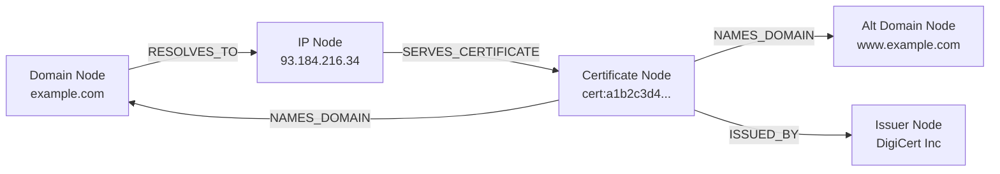

# ANIE — Milestone 3.7: Multi-Vector Observable Ingestion (Passive TLS & X.509 Certificate Correlation)

**Owner:** Antigravity (Anti)  
**Baseline Commit:** `68d370f` (M3.6) + `feat/m3.7-intelligence-hardening-and-next-milestone`  
**Status:** Approved for Implementation  
**Licensing:** Apache 2.0 Open Source Core  

---

## 1. Executive Summary & Objective

The Autonomous Network Intelligence Engine (ANIE) was designed to produce empirically grounded, cryptographically authenticated network observations without violating target privacy or performing active invasive probing.

Milestones M3.1 through M3.6 established:
1. Fail-closed security preflight and systemd sandbox isolation (M3.1).
2. Independent Ed25519 attestation and hash-chain provenance (M3.2).
3. Multi-resolver DNS disagreement detection (M3.3).
4. Graph-native epistemic data store with FTS5 and 1-hop latency budgets (M3.4).
5. Offline RFC 9224 RDAP enrichment, temporal anomaly detection, and Obsidian vault export (M3.6).

In accordance with Increment 2 of the approved [ANIE Research Plan](RESEARCH_PLAN.md) and Section 5 of [Phase 3 Architecture Revision](PHASE3_ARCHITECTURE_REVISION.md), **Milestone M3.7** introduces **Multi-Vector Observable Ingestion: Passive TLS & X.509 Certificate Provenance Correlation**.

### Core Problem
DNS observations establish mappings between domains and IP addresses ($D \rightarrow IP$). However, shared hosting, Content Delivery Networks (CDNs), and anycast infrastructure frequently obscure whether co-located domains share administrative control, infrastructure dependencies, or merely shared tenancy.

X.509 cryptographic certificates observed during TLS handshakes provide an immutable, cryptographic multi-lateral bridge:
- A single certificate binds a cryptographic public key (`SPKI`) to multiple Subject Alternative Names (SANs) and a Subject Common Name (`CN`).
- Certificates are served over specific IP endpoints on port 443.
- Certificates are cryptographically signed by issuing authorities (`Issuer DN`).

By incorporating passive TLS certificate observations into ANIE's temporal intelligence graph, ANIE achieves deep infrastructure correlation while maintaining strict epistemic boundaries.

---

## 2. Architectural Guardrails & Invariants

```
+-----------------------------------------------------------------------------------+
|                         M3.7 ARCHITECTURAL INVARIANTS                             |
+-----------------------------------------------------------------------------------+
|  1. Passive / Staged Telemetry Only: Zero active exploratory network crawling.     |
|  2. Strict Epistemic Separation: Wire bytes (FACT) vs SAN edges (DERIVED).        |
|  3. Multi-Tenant Guardrail: Shared CDN / Let's Encrypt != Common Ownership.       |
|  4. Hardware Envelope: Run within 1 GiB micro VM (<50 MiB RSS, <10 ms 1-hop).     |
|  5. Cryptographic Immutability: Certificate identified by canonical SHA-256.      |
|  6. Zero-Dependency Parser: Use standard cryptography / hashlib / ssl modules.   |
+-----------------------------------------------------------------------------------+
```

### Invariant 1: Passive Ingestion Only
In accordance with Core Tenet 4 and RFC 5737 isolation policies, ANIE collectors do NOT perform port-scanning, crawler expansion, or indiscriminate Internet-wide SYN probes. Ingestion of TLS metadata is performed either:
- Passively from observed client connections / tap feeds.
- Through pre-authorized target probing during scheduled pilot batches under strict rate-limiting.
- From offline cryptographic certificate bundles (PEM / DER / CT log extracts).

### Invariant 2: Epistemic Layering
- **Layer 1 (FACT):** Raw DER bytes, SHA-256 certificate fingerprint, Subject Public Key Info (SPKI) SHA-256 digest, raw validity timestamps, and the exact IP address and port from which the certificate was retrieved.
- **Layer 2 (DERIVED):** Parsed SAN domain names, Common Name, issuer organization, and relationship edges (`SERVES_CERTIFICATE`, `NAMES_DOMAIN`, `ISSUED_BY`).
- **Layer 3 (HYPOTHESIS):** Inferred shared infrastructure, certificate novelty, or rotation anomalies.

### Invariant 3: Anti-Guilt-By-Association Guardrails
- Public multi-domain certificates (e.g. Cloudflare shared edge certificates with 50+ unrelated SANs, Let's Encrypt multi-tenant certs) must be tagged with `IS_SHARED_MULTI_TENANT_CERTIFICATE`.
- Under no circumstances shall shared multi-tenant certificates be used to infer common ownership, coordinated operation, or malicious affiliation.
- Self-signed or expired certificates are classified factually (`UNTRUSTED_ISSUER`, `CERTIFICATE_EXPIRED`) without subjective attribution.

---

## 3. Entity Graph Model & Canonical Identifiers

### Canonical URIs (`src/anie/canonical_entities.py`)
- **Certificate:** `anie:entity:cert:<sha256_fingerprint>` (canonical URI: `cert:<sha256_hex>`)
- **Domain:** `anie:entity:domain:<fqdn>` (canonical URI: `domain:<fqdn>`)
- **IP:** `anie:entity:ip:<normalized_ip>` (canonical URI: `ipv4:<ip>` or `ipv6:<ip>`)

### Node Types (`src/anie/graph_models.py`)
- `NodeType.CERTIFICATE = "certificate"`

### Relation Types (`src/anie/graph_models.py`)
- `RelationType.SERVES_CERTIFICATE`: `(IP) -> (CERTIFICATE)` or `(DOMAIN) -> (CERTIFICATE)`
- `RelationType.NAMES_DOMAIN`: `(CERTIFICATE) -> (DOMAIN)` (extracted from Subject Alternative Names and CN)
- `RelationType.ISSUED_BY`: `(CERTIFICATE) -> (ORGANIZATION / ISSUER)`



---

## 4. Technical Specification

### 4.1. Data Models (`src/anie/real_models.py`)
```python
@dataclass(frozen=True)
class RealTlsCertificate:
    """Immutable parsed X.509 certificate observation."""
    sha256_fingerprint: str          # Lowercase 64-character hex
    spki_sha256: str                 # Subject Public Key Info SHA-256
    subject_cn: str | None           # Common Name
    subject_alt_names: tuple[str, ...] # Normalized lowercase FQDNs
    issuer_cn: str | None            # Issuer Common Name
    issuer_org: str | None           # Issuer Organization
    serial_number: str               # Decimal or hex string
    not_before: str                  # ISO 8601 UTC
    not_after: str                   # ISO 8601 UTC
    is_self_signed: bool             # subject == issuer
    raw_der_sha256: str              # Digest of raw wire bytes
```

### 4.2. Ingestion & Graph Extraction (`src/anie/tls_enrichment.py`)
- Standard library `cryptography.x509` or `ssl.DER_cert_to_PEM_cert`: parse X.509 certificates offline without network calls.
- Normalization:
  - SANs: lowercase, punycode-decoded, deduplicated, sorted.
  - Fingerprints: lowercase hexadecimal SHA-256.
  - Timestamps: standard UTC ISO 8601.
- Graph Nodes & Edges Generation:
  - `GraphNode(node_id="anie:entity:cert:<fp>", node_type="certificate", layer="FACT")`
  - `GraphEdge(source_id="anie:entity:ip:<ip>", target_id="anie:entity:cert:<fp>", relation_type="SERVES_CERTIFICATE", layer="FACT")`
  - For each SAN: `GraphEdge(source_id="anie:entity:cert:<fp>", target_id="anie:entity:domain:<san>", relation_type="NAMES_DOMAIN", layer="DERIVED")`

### 4.3. Obsidian Vault Export Integration (`src/anie/graph_engine.py`)
- Notes exported to `vault/certificates/<sanitized_fp>.md`.
- Frontmatter:
  ```yaml
  ---
  id: "anie:entity:cert:a1b2c3d4..."
  type: "certificate"
  fingerprint: "a1b2c3d4..."
  subject_cn: "example.com"
  issuer: "DigiCert Global Root CA"
  not_before: "2026-01-01T00:00:00Z"
  not_after: "2027-01-01T00:00:00Z"
  is_self_signed: false
  ---
  ```
- Bidirectional wikilinks:
  - `[[ips/<safe_ip>|<ip>]]`
  - `[[domains/<safe_domain>|<domain>]]`

---

## 5. Implementation Tasks & Verification Plan

1. **Entities & Canonical URIs:**
   - Update `src/anie/canonical_entities.py` to support `ENTITY_TYPE_CERT = "cert"`.
   - Update `src/anie/graph_models.py` with `NodeType.CERTIFICATE` and relation types `SERVES_CERTIFICATE`, `NAMES_DOMAIN`, `ISSUED_BY`.
2. **TLS Observation Models & Enrichment Engine:**
   - Create `src/anie/tls_enrichment.py` providing `TlsEnricher` to parse X.509 PEM/DER certificates deterministically and generate graph nodes and edges.
   - Tag multi-tenant certificates (e.g., >20 SANs or wildcard SANs on known CDN domains).
3. **Graph Engine & Obsidian Vault Support:**
   - Update `GraphEngine.export_obsidian_vault` to query and export `certificates/` folder with wikilinks to domains and IPs.
4. **Verification & Regression Testing:**
   - Dedicated test suite `tests/test_m3_7_tls_enrichment.py`.
   - Re-run full test discovery (`450+ tests`) and `tools/check_repo.py`.
