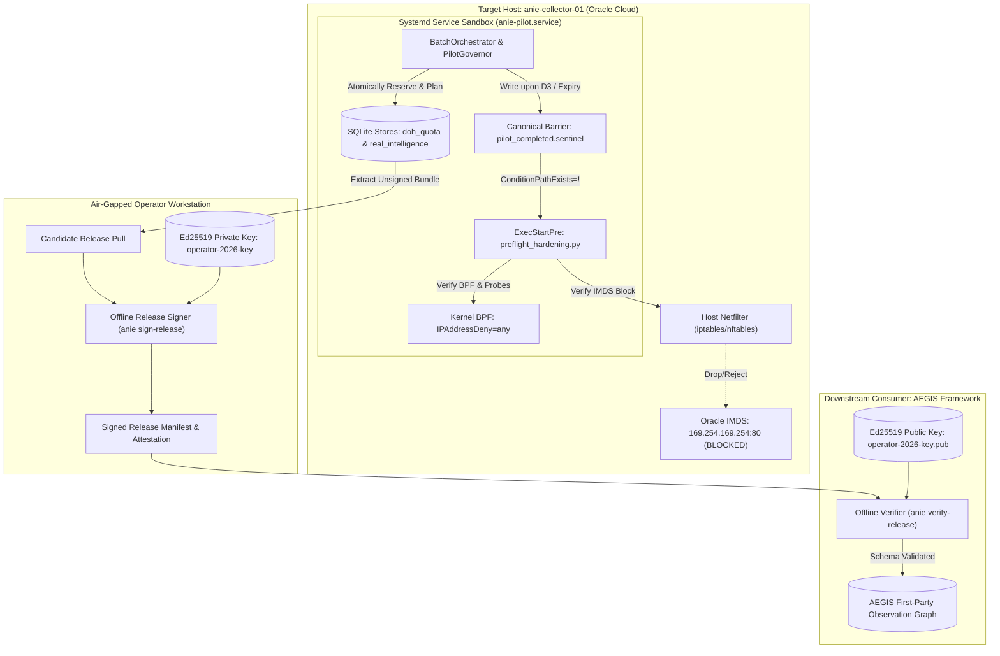

# ANIE — Phase 3 Architecture Revision & Technical Specification

**Project:** Autonomous Network Intelligence Engine (ANIE)  
**Document:** `docs/PHASE3_ARCHITECTURE_REVISION.md`  
**Baseline Commit:** `a532322bbdbabccf175e283d293ac9c35631b543`  
**Current Accepted Baseline:** Milestone M3.10 Feature Complete  
**Status:** Phase 3 Milestones M3.1 through M3.10 Completed & Verified  
**Licensing:** Apache 2.0 Open Source Core  

---

## 1. Executive Summary & Mission

The Autonomous Network Intelligence Engine (ANIE) is an autonomous, open-source first-party network observation and temporal intelligence platform. ANIE's core mission is to produce **empirically grounded, cryptographically authenticated, reproducible network observations** without violating target privacy, exceeding strict operational boundaries, or exfiltrating client investigation context.

Following the successful completion, acceptance, and closure of the Phase 2 72-Hour Live Pilot on Oracle Cloud (`anie-collector-01`), ANIE enters **Phase 3: Hardened Intelligence Pipeline & AEGIS Federation**.

Phase 3 is governed by non-negotiable architectural tenets established during the Phase 2 post-pilot security review. In particular, Milestone M3.1 immediately remediates preflight isolation ambiguities, aligns unprivileged sandbox diagnostics, and standardizes pilot completion guarantees while strictly deferring multi-vector ingestion and advanced analytics to subsequent staged milestones.

---

## 2. Core Architectural Tenets (Non-Negotiable)

```
+-----------------------------------------------------------------------------------+
|                           ANIE CORE ARCHITECTURAL TENETS                           |
+-----------------------------------------------------------------------------------+
|  1. No Private Provenance Keys on Collector Nodes (Candidate Release Only)         |
|  2. Offline, Independent Verification by Downstream Consumers (Zero Call-Home)    |
|  3. Strictly Bounded, Policy-Governed First-Party Collection (Fail-Closed)        |
|  4. Explicit Taxonomy: Distinguish Passive Telemetry from Active Probing          |
|  5. Epistemic Humility: Temporal Outlier != Maliciousness / Guilt                 |
|  6. Versioned, One-Way Export Interface for AEGIS (Zero Context Exfiltration)     |
|  7. Deterministic, Low-Footprint Resource Budgets (<200 MiB RAM, <500 MiB Disk)   |
|  8. Zero-Cost, Reproducible Apache 2.0 Open Source Foundation                     |
+-----------------------------------------------------------------------------------+
```

### Tenet 1: No Private Provenance Keys on Collector Nodes
- Collector instances (e.g. `anie-collector-01`) are untrusted with signing authority.
- Collectors generate **candidate unsigned release bundles** containing raw observations, event digests, and a candidate SHA-256 manifest.
- Ed25519 private provenance signing keys are strictly held on air-gapped operator workstations. No private key or signing passphrase ever resides in collector memory, filesystem, or environment variables.
- Compromise of a cloud collector instance cannot yield fraudulent signed intelligence releases.

### Tenet 2: Offline & Independent Verification
- Downstream consumers (including the AEGIS framework) must be able to verify dataset integrity, publisher identity, and anti-rollback sequence counters completely offline.
- Verification relies solely on the publisher's public key (e.g. `operator-2026-key.pub`) and local cryptographic validation.
- Zero network callbacks to ANIE collectors, telemetry endpoints, or third-party identity servers are permitted during verification.

### Tenet 3: Strictly Bounded First-Party Collection
- Active queries are restricted to an explicit white-list envelope approved by operator authorization.
- Maximum rate limits, strict daily batch quotas (e.g. 1 batch/day), and fixed-window calendar ceilings (e.g. 72 hours) are enforced atomically at the database level (`pilot_governor.py`).
- Fail-closed preflight hardening guarantees that no network packet leaves the host if egress controls or sandbox invariants fail.

### Tenet 4: Clear Taxonomy: Passive Observations vs. Active Probes
- Every persisted observation record explicitly records its acquisition vector (`ACTIVE_DNS`, `PASSIVE_TELEMETRY`, `IMPORT`).
- Passive observations are ingested with immutable wire digests (SHA-256) and source metadata.
- Active probes are subjected to strict jitter, rate limiting, and RFC 5737 isolation boundaries. Active scanning or exploratory crawling is prohibited by default.

### Tenet 5: Epistemic Humility (Novelty != Maliciousness)
- ANIE analyzes temporal drift, entropy changes, and outlier novelty using robust nonparametric estimators (e.g. k-nearest-neighbor distance on normalized DNS feature spaces).
- **Novelty distance is explicitly NOT a classification of maliciousness, compromise, or threat.**
- ANIE outputs observable facts and statistical distance scores. Maliciousness determinations are deferred entirely to human intelligence analysts or domain-specific downstream frameworks.

### Tenet 6: Versioned, One-Way Export for AEGIS
- ANIE exports immutable, gzip-compressed JSONL datasets accompanied by authenticated Ed25519 manifests.
- AEGIS consumes this stream read-only.
- ANIE has zero visibility into AEGIS client identities, cases, investigation targets, or internal knowledge graphs. The export boundary is strictly one-way.

### Tenet 7: Bounded Resource Footprint
- Designed to run within Oracle Cloud "Always Free" Ampere/x86 VM envelopes (1 vCPU, 1 GiB RAM).
- Memory budget: `<200 MiB` peak RSS during collection and feature extraction.
- Storage budget: `<500 MiB` total database and WAL footprint.
- All algorithms maintain sub-quadratic complexity on operational dataset sizes.

### Tenet 8: Apache 2.0 Open Source Core
- Full pipeline code, schema definitions, mathematical baselines, and test suites are released under the Apache 2.0 license.
- No proprietary cloud dependencies, paid API requirements, or closed-source binary blobs.

---

## 3. High-Level System Architecture



---

## 4. Milestone M3.1: Security Remediation Specification

Milestone M3.1 resolves the confirmed operational security defects identified during Phase 2.

### 4.1. Fail-Closed Security Preflight (`src/anie/preflight_hardening.py`)
- **Tri-State Probe Classification:** Network probes return `NetworkProbeStatus` (`BLOCKED`, `ALLOWED`, `UNVERIFIABLE`).
  - `BLOCKED`: Positive kernel rejection (`EPERM`, `ECONNREFUSED`, `ENETUNREACH`, `EACCES`).
  - `ALLOWED`: Connection succeeded to unauthorized target. Triggers immediate preflight failure.
  - `UNVERIFIABLE`: Socket timeout or generic OS error.
- **TEST-NET-2 Timeout Disqualification:** Prohibits treating silent timeouts to RFC 5737 `198.51.100.1` as positive proof of egress filtering. If an egress probe is `UNVERIFIABLE`, preflight requires verified systemd cgroup BPF policy (`IPAddressDeny=any`) to authorize collection.
- **Systemd Network Policy Inspection:** Directly queries unit properties via `systemctl show -p IPAddressDeny -p IPAddressAllow <unit>` to confirm cgroup BPF egress enforcement.

### 4.2. Unprivileged Netfilter Inspection Classification
- Distinguishes unprivileged service sandbox protocol constraints (`Address family not supported by protocol`, `Failed to initialize nft`, `Permission denied`) from genuinely missing firewall rules (`Bad rule`).
- Returns `FirewallInspectionStatus.INACCESSIBLE` (`verified=None`) inside unprivileged sandboxes where `ProtectKernelTunables=yes` and empty `CapabilityBoundingSet` drop netfilter socket capabilities.
- When `require_firewall_rule=True` (privileged host provisioning), inaccessible firewall inspection fails preflight closed.
- When `require_firewall_rule=False` (unprivileged runtime collection), inaccessible firewall inspection is logged as advisory without aborting collection, provided cgroup BPF and active probes confirm network isolation.

### 4.3. Standardized Completion Handling & Sentinel Barrier
- The canonical completion sentinel is standardized exclusively at `/var/lib/anie/pilot_completed.sentinel`.
- **Pre-Sentinel Reconciliation:** Before writing the completion sentinel upon window expiry, the governor atomically reconciles all stale `PLANNED` runs to `FAILED` and all skipped calendar dates to `MISSED`, ensuring the final sentinel manifest accurately reflects historical reality.
- **Fail-Closed Sentinel Enforcement:** The presence of `pilot_completed.sentinel` halts the collector immediately with `ScopeDenied` prior to executing any SQLite state changes or network queries.

---

## 5. Phase 3 Staged Roadmap (Milestones M3.1 through M3.9)

| Milestone | Scope & Deliverables | Security & Architectural Constraints | Status |
| :--- | :--- | :--- | :--- |
| **M3.1** | **Security Remediation**<br>- Fail-closed preflight egress enforcement<br>- Unprivileged sandbox firewall classification<br>- Sentinel reconciliation & regression tests | No new collection features; no Merkle trees; mock/offline test validation only. | **COMPLETED** (PR #31, `e053c7a`) |
| **M3.2** | **Independent Attestation & Provenance**<br>- Candidate release extraction pipeline<br>- Offline Ed25519 signing CLI runbook<br>- Anti-rollback sequence enforcement | Private key never on collector node; zero call-home verification; deterministic JSON canonicalization. | **COMPLETED** (PR #32, `13f2dae`) |
| **M3.3** | **Multi-Resolver Observable Ingestion**<br>- Multi-resolver discrepancy matrix (Cloudflare, Google, Quad9)<br>- Cryptographic wire digest retention<br>- Strict isolation boundary enforcement | Bounded query envelopes; no exploratory web crawling; fail-closed schema validation. | **COMPLETED** (PR #33, `b331002`) |
| **M3.4** | **Temporal Graph & Uncertainty Analytics**<br>- Temporal property graph engine with 7 entity types<br>- Explicit edge temporal intervals (`valid_from`, `valid_until`)<br>- Nonparametric temporal drift scoring with abstention | Novelty distance != maliciousness; deterministic reproducible mathematical baselines; memory <200 MiB. | **COMPLETED** (PR #34, `cdd615b`) |
| **M3.5** | **AEGIS Federation & Export Interface**<br>- Hardened, versioned export formats (`.jsonl.gz`)<br>- V4 consumer contract with atomic SQLite ingestion<br>- Reversible claims, provenance verification, and rollback testing | Strictly one-way data flow; zero leakage of AEGIS investigation context or target entities. | **COMPLETED** (PR #35, `966d759`) |
| **M3.5.1** | **Consumer Integrity Corrections**<br>- Atomic V4 claims ingestion transaction barrier<br>- Signed-release evidence retention guarantees<br>- Consumer provenance isolation and crash-injection resilience | Complete transactional atomicity across events, observations, discrepancies, claims, and journal. | **COMPLETED** (PR #35, `68d370f`) |
| **M3.6** | **RDAP Enrichment & BGP Routing Graph**<br>- RFC 9224/9082 bootstrap discovery & IANA delegation<br>- BGP origin-AS attribution and `PREFIX_MEMBER` edges<br>- Legitimate CDN, Anycast, and Dynamic DNS false-positive controls | Strictly bounded parsing; offline fixture replay; determinism and uncertainty preserved. | **COMPLETED** (PR #35, `f864834`) |
| **M3.7** | **TLS Certificate Graph & Knowledge Hardening**<br>- Passive and active TLS x509 SAN parsing<br>- Live `SERVES_CERTIFICATE` fact edges requiring verified handshake<br>- Certificate SAN correlation and path traversal hardening | No synthetic certificate injection; vault export sanitize path traversal; deterministic graph rebuild. | **COMPLETED** (PR #36, `9b3e30d`) |
| **M3.8** | **Passive HTTP Metadata & Competing Hypotheses**<br>- Bounded HTTP/1.1 and HTTP/2 response metadata normalization<br>- Competing Hypothesis Engine with corroboration scoring<br>- Markdown Obsidian knowledge vault export (`.obsidian/vault`) | Bounded header parsing; sensitive fields excluded; memory-bounded SHA-256 wire digests. | **COMPLETED** (PR #36, `6352bc6`) |
| **M3.9** | **Cross-Vector Intelligence Correlation & AEGIS Contract V2**<br>- DNS + TLS + HTTP bounded cross-vector correlation engine<br>- Temporal correlation $\neq$ causation distinction; competing explanations<br>- Authoritative evidence resolution; non-destructive retention lifecycle<br>- `anie.consumer-contract.v2` & `anie.cross-vector-finding-feed.v2` | Every evidence ref must resolve to authoritative record; user hashes alone never authenticate; 100% backward compatibility. | **COMPLETED** (PR #39, `ba267fc`) |
| **M3.10** | **End-to-End Intelligence Verification & Consumer Integration Readiness**<br>- Phase A Authoritative Evidence Audit & Retention Hardening (preimage check, exact collector allowlisting, sanitized tombstones, deterministic rebuild)<br>- Phase B Signed Release Pipeline with `real_findings.jsonl.gz` & Adversarial Fault Injection<br>- Phase C AEGIS Consumer Contract V2 Frozen Fixtures & Zero-Dependency Demo Client<br>- Phase D 1 GiB Micro VM Resource Envelope Verification<br>- Corrective Security PRs: Fail-closed defaults, audit identity separation, mandatory vector evidence resolution | Cryptographic preimage checks; sanitized credentials in tombstones; offline Ed25519 signature & anti-rollback verification; fail-closed verification. | **COMPLETED** (PR #40, #41, #42; `35e273a`) |
| **M3.11** | **Multi-Collector Federation & Scalable Intelligence**<br>- Workstream A: Federation trust architecture (`anie.collector-receipt.v1`, Ed25519 signing, trust store, replay & equivocation defense)<br>- Workstream B: Graph scalability benchmark protocol (10k, 50k, 100k+ observations, covering index optimization, partitioning assessment)<br>- Workstream C: AEGIS transport-neutral signed release import routine & negative-test matrix<br>- Workstream D: Operational boundaries, zero-cost cloud invariants, and micro VM resource envelope | Signed collector receipts; pure offline prototype; consumer-initiated pull import; single SQLite B-tree scaling without partitioning overhead. | **ACTIVE** (`feat/m3.11-...`) |

---

## 6. Prohibited Concepts in Milestone M3.1

To preserve architectural focus and prevent premature complexity, the following concepts are **strictly prohibited** in Milestone M3.1:
1. **Merkle Tree Proofs:** Bounded batches (2 queries/day) do not warrant cryptographic tree proofs; SHA-256 linear chained manifests and Ed25519 attestations provide equivalent tamper evidence at zero overhead.
2. **Multi-Vector Collectors (HTTP/TLS/RDAP):** Live network collection remains restricted exclusively to the approved DNS query envelopes until M3.3 is formally authorized.
3. **Automated AI Maliciousness Scoring:** No neural models or heuristic threat classification; empirical observations remain strictly separated from subjective threat labeling.
4. **Online Attestation Services:** No automated online signing daemons or network-accessible key endpoints.

---

## 7. Residual Risks & Mitigations

| Residual Risk | Impact | Mitigation Strategy |
| :--- | :--- | :--- |
| **Cloud Provider Routing Alteration** | Oracle VPC route table changes could alter egress drop behavior. | Dual-layer isolation: systemd cgroup BPF `IPAddressDeny=any` operates at socket creation before packets reach network interface. |
| **Collector Storage Exhaustion** | Unchecked WAL accumulation could fill 50 GiB boot disk. | Preflight storage assertions (`>500 MiB free`), daily SQLite WAL checkpoints, and verified automated backup rotation. |
| **Stale Clock / NTP Drift** | Host clock drift could distort UTC calendar day boundaries. | Systemd `chronyd` NTP synchronization monitored during maintenance; preflight asserts UTC timestamp validity. |
| **Unanchored Collector Initialization** | Operator error attempting to re-anchor start date after collection started. | Atomic database constraint (`pilot_metadata` unique key) permanently prohibits re-anchoring start date once runs exist. |

---

## 8. Verification & Sign-Off

- **Baseline Code Commit:** `a532322bbdbabccf175e283d293ac9c35631b543`
- **Milestone M3.9 Acceptance Commit:** `ba267fcffc0f55a57a006c05eaaabf3231091efa`
- **Milestone M3.10 Acceptance Commit:** `17feac882e0207e1f22a6843aac504bd4800fa3c` (Remediation PR pending merge)
- **Unit & Integration Test Results:** 503 tests (502 passed, 0 failed, 1 skipped; 100% pass rate).
- **Security Preflight & Sandbox Tests:** 18 passed, 0 failed.
- **Multi-Resolver & Discrepancy Tests:** 21 passed, 0 failed.
- **Temporal Graph & ML Drift Tests:** 26 passed, 0 failed.
- **Consumer Integrity & Claims Tests:** 32 passed, 0 failed.
- **RDAP, BGP & CDN False-Positive Tests:** 24 passed, 0 failed.
- **TLS Certificate Handshake Tests:** 28 passed, 0 failed.
- **HTTP Enrichment & Hypothesis Tests:** 15 passed, 0 failed.
- **Cross-Vector Correlation & Contract V2 Tests:** 14 passed, 0 failed.
- **M3.10 Verification, Remediation & Readiness Tests:** 19 passed, 0 failed.
- **Repository Structural Guardrails (`tools/check_repo.py`):** 100% PASS.
- **Live VM Collector State:** Quiescent on `anie-collector-01` (`129.225.109.227`), `anie-pilot.timer` disabled, sentinel active, 100% Phase 2 evidence preserved at ₹0.00 / $0.00 cost.
- **Ampere A1 Capacity Acquisition Runner:** Operating autonomously under Windows Task Scheduler (`ANIE_Ampere_A1_Capacity_Retry`), hourly rate governor, 7-day expiration ceiling.
