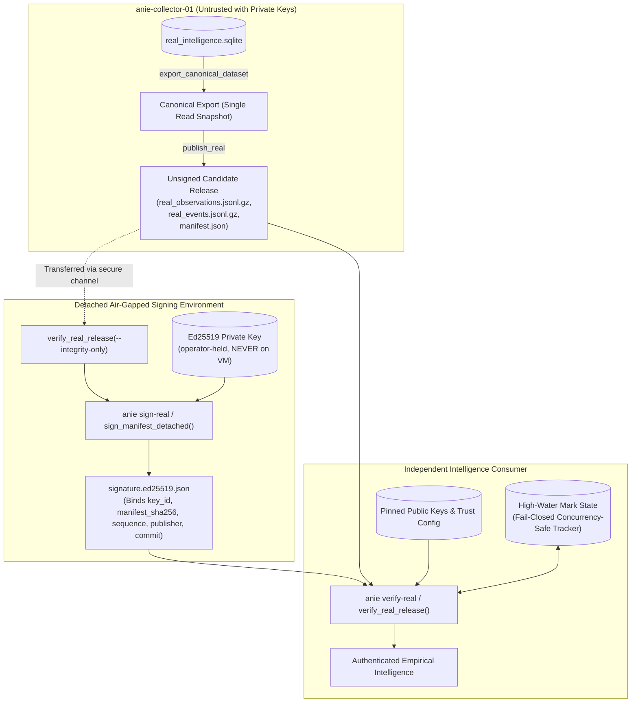

# ANIE Authenticated Real-Data Publication & Detached Signing Guide

Part of ANIE Phase 2 PR 4: Authenticated First-Party Intelligence Publication.

## 1. Architectural Overview & Boundaries

The ANIE Real-Data Publication pipeline produces deterministic, independently verifiable, cryptographically authenticated releases of genuine first-party internet intelligence measurements.



### Core Security Invariants
1. **Air-Gapped Private Keys:** Primary Ed25519 private keys (`Ed25519PrivateKey`) **never reside on the collector VM** (`anie-collector-01`). The collector VM only produces unsigned candidate releases and manifest digests via `publish_real`.
2. **Deterministic Reproducibility:** Data partitions are formatted in canonical JSON, strictly sorted (`observed_at ASC, observation_id ASC` for observations; `observed_at ASC, event_id ASC` for events), and compressed with fixed gzip headers (`mtime=0`, empty filename, `compresslevel=9`). When `published_at` is fixed (e.g. via `--published-at`), the manifest and partition archives are 100% byte-for-byte identical across independent publication builds.
3. **Anti-Contamination Enforcement:** Synthetic fixtures (`synthetic=True`, `method="synthetic"`, `source_id="synthetic:..."`) are unconditionally rejected by the real-data publication engine with `PermissionError`.
4. **Complete Model Verification:** During verification, every record is reconstructed through strict dataclass model validators (`RealObservation.from_dict` and `RealCollectionEvent.from_dict`), validating content-addressed IDs, raw DNS wire evidence (`raw_sha256`), non-synthetic provenance, and strict ordering.
5. **Memory-Bounded Streaming:** Ingestion, publication, and verification stream line-by-line with bounded buffers. The uncompressed partition ceiling ($\le 100\text{ MiB}$) and single-record limit ($\le 500\text{ KiB}$) prevent decompression bombs and memory exhaustion on 1 GiB RAM instances.
6. **Binds All Authenticated Metadata:** Signing and verification enforce complete cryptographic agreement between manifest publisher, payload publisher, sequence numbers, git commits, attestation key IDs, and operator trust policies.
7. **Authenticates Publisher, Not External Truth:** A valid Ed25519 signature authenticates that the release was assembled and published by the authorized keyholder without tampering; it does not attest to the absolute truth of third-party DNS authoritative answers.

---

## 2. Separate Integrity from Authentication

`verify_real_release()` distinguishes four distinct verification tiers:
- `structural_valid`: Directory, manifest schema, file presence, and compressed file size limits.
- `evidence_integrity_valid`: Record schema conformance, content-addressed IDs, raw evidence wire hashes, deterministic ordering, and referential consistency.
- `publisher_authenticated`: Detached Ed25519 cryptographic signature verified against pinned operator trust policy.
- `anti_rollback_verified`: Monotonic release sequence verified against persistent state tracker.

### Result Contract
When verifying an unsigned candidate with `--integrity-only`:
```json
{
  "status": "CANDIDATE_INTEGRITY_VERIFIED",
  "authenticated": false,
  "integrity_only": true,
  "structural_valid": true,
  "evidence_integrity_valid": true,
  "publisher_authenticated": false,
  "anti_rollback_verified": false
}
```
When verifying an authenticated release with a trusted key:
```json
{
  "status": "AUTHENTICATED",
  "authenticated": true,
  "integrity_only": false,
  "structural_valid": true,
  "evidence_integrity_valid": true,
  "publisher_authenticated": true,
  "anti_rollback_verified": true
}
```
Unsigned candidate inspection is **never represented as authenticated publication**. Verification without `--key-file` or `--integrity-only` fails closed with exit code 2.

---

## 3. Replay & Rollback Protection

### The Stateless Verification Limitation
**Stateless cryptographic signature verification alone cannot prevent replay or rollback attacks.**
If an attacker intercepts or caches a previously signed genuine release (e.g. sequence 4), the cryptographic signature over sequence 4 will remain mathematically valid until `expires_at`. An attacker could present this historical release to downgrade a consumer's active intelligence view.

### The Solution: Monotonic Sequences and Persistent State
ANIE implements defense-in-depth rollback protection:
1. **Monotonically Increasing Release Sequence:** Every signed release binds an integer `release_sequence` (strictly $\ge 1$).
2. **Persistent Verifier High-Water Mark (`ReleaseSequenceTracker`):** The consumer verifier maintains a local state file recording the highest accepted sequence for each publisher channel:
   - When a release is verified, `release_sequence` must be strictly greater than the recorded sequence (`sequence > last_accepted`).
   - If `sequence <= last_accepted`, verification fails closed with a rollback rejection error:
     ```
     ValueError: release sequence 4 is replayed or downgraded (last accepted sequence was 5); rejection enforced for rollback protection
     ```
3. **Fail-Closed State Handling:**
   - Corrupted or unreadable state files raise `TrackerStateError` and never reset accepted sequences to zero.
   - Deleted or missing state files after initialization raise `TrackerStateLostError`.
   - Multi-process advisory locking (`msvcrt` on Windows, `fcntl` on POSIX) prevents race conditions and ensures a lower sequence cannot overwrite a higher sequence.
4. **Controlled Historical Auditing (`--allow-rollback`):** When historical forensic auditing is deliberately required, consumers can pass `--allow-rollback`, which permits historical verification without mutating the persistent high-water mark.

### Local State Boundary Notice
> [!WARNING]
> Deletion, truncation, or filesystem snapshot rollback of the local verifier state file **cannot be detected locally** without a trusted external anchor (such as a transparency log, TPM monotonic counter, or multi-party distributed consensus). Local rollback protection assumes the local filesystem storage path is protected against unauthorized tampering or arbitrary deletion.

---

## 4. Detached Operator Signing Runbook

### Step 1: Export Unsigned Candidate on the Collector VM
On `anie-collector-01` (collector VM has NO private keys):
```bash
anie publish-real \
    --db /var/lib/anie/real_intelligence.sqlite \
    --out /var/lib/anie/releases/release-2026-11-12 \
    --as-of "2026-11-12T12:00:00Z" \
    --sequence 1 \
    --publisher "anie-first-party"
```
The output directory contains:
- `real_observations.jsonl.gz`
- `real_events.jsonl.gz`
- `manifest.json` (unsigned candidate manifest)

### Step 2: Transfer Candidate Release to Secure Signing Workstation
Transfer the candidate directory to the isolated operator machine via secure transfer (e.g. `scp`, SFTP, or staged artifact repository).

### Step 3: Inspect Candidate Integrity (Pre-Signing Audit)
On the secure signing workstation:
```bash
anie verify-real \
    --dir /path/to/release-2026-11-12 \
    --integrity-only
```
Ensures evidence schemas, raw wire hashes, deterministic ordering, and record counts are valid before any signing occurs.

### Step 4: Detached Signing in Trusted Environment
On the operator signing machine (holding the Ed25519 private key in PEM or 32 raw bytes):
```bash
anie sign-real \
    --dir /path/to/release-2026-11-12 \
    --key-file /secure/keys/operator-2026a.key \
    --key-id "operator-key-2026a" \
    --sequence 1 \
    --publisher "anie-first-party" \
    --valid-days 30
```
Or programmatically using the Python API:
```python
from anie.real_publish import load_private_key_file, sign_manifest_detached

priv_key = load_private_key_file("/secure/keys/operator-2026a.key")
sign_manifest_detached(
    "/path/to/release-2026-11-12",
    priv_key,
    key_id="operator-key-2026a",
    release_sequence=1,
    issued_at="2026-11-12T12:05:00Z",
    expires_at="2026-12-12T12:05:00Z",
    publisher_identity="anie-first-party",
)
```
This writes `signature.ed25519.json` into the release directory without private keys ever touching the collector host.

---

## 5. Consumer Verification Runbook

### Independent Authenticated Verification via CLI
Consumers verify downloaded release bundles using an operator-pinned public key:
```bash
anie verify-real \
    --dir /path/to/downloaded/release-2026-11-12 \
    --key-file /etc/anie/trusted_keys/operator-2026a.pub \
    --key-id "operator-key-2026a" \
    --state-file /var/lib/anie/verifier_state.json \
    --init-state
```

Output:
```json
{
  "status": "AUTHENTICATED",
  "authenticated": true,
  "integrity_only": false,
  "structural_valid": true,
  "evidence_integrity_valid": true,
  "publisher_authenticated": true,
  "anti_rollback_verified": true,
  "dataset_type": "first_party_intelligence",
  "release_sequence": 1,
  "total_observations": 120,
  "total_events": 120,
  "manifest_sha256": "4b82d4...",
  "publisher_identity": "anie-first-party",
  "key_id": "operator-key-2026a",
  "key_fingerprint": "8a3f91...",
  "safe_to_autonomously_act": false,
  "publisher_real_world_identity_verified": false
}
```

---

## 6. Key Rotation & Revocation Procedures

### Multi-Key Trust Configuration
To rotate keys without invalidating historical releases, `RealReleaseTrust` maintains a map of multiple authorized keys with distinct validity windows:

```python
from anie.real_publish import RealReleaseTrust, TrustedKey

trust = RealReleaseTrust(
    trusted_keys={
        "operator-key-2026a": TrustedKey(
            key_id="operator-key-2026a",
            public_key_raw=key_2026a_pub,
            valid_from="2026-01-01T00:00:00Z",
            valid_until="2026-07-01T00:00:00Z",
        ),
        "operator-key-2026b": TrustedKey(
            key_id="operator-key-2026b",
            public_key_raw=key_2026b_pub,
            valid_from="2026-06-01T00:00:00Z",
            valid_until="2027-01-01T00:00:00Z",
        ),
    },
    revoked_key_ids=frozenset({"compromised-key-id"}),
    revoked_fingerprints=frozenset({"compromised_sha256_fingerprint"}),
)
```

### Emergency Revocation
If a signing private key is compromised:
1. Immediately add the compromised `key_id` to `revoked_key_ids` and its SHA-256 fingerprint to `revoked_fingerprints`.
2. Any candidate release signed by the revoked key will be rejected unconditionally with `ValueError: signing key_id '...' has been revoked by operator trust policy`.
