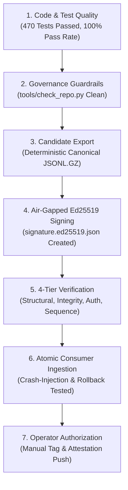

# ANIE Release Process & Detached Provenance Protocol

**Project:** Autonomous Network Intelligence Engine (ANIE)  
**Document:** `docs/RELEASE_PROCESS.md`  
**Accepted Baseline:** Milestone M3.8 (`6352bc6`)  
**Security Classification:** Strict Operator Governance & Air-Gapped Attestation

---

## 1. Versioning & Contract Policies

ANIE maintains strict version separation across source code, data schemas, and mathematical models:

1. **Source Code Versioning:**
   - Adheres to Semantic Versioning (`vMAJOR.MINOR.PATCH`).
   - Git tags (`v3.8.0`) are signed and pushed only upon operator sign-off.
   - `pyproject.toml` and `src/anie/__init__.py` must be synchronized.
2. **Wire Schema Contracts:**
   - Intelligence Schema: `schemas/intelligence-v1.schema.json` (`anie.intelligence.v1`).
   - Observation Schema: `anie.observations.v1`.
   - Detached Attestation Schema: `anie.attestation.v1`.
   - Consumer Claims Schema: `anie.claims.v4` (AEGIS V4 contract).
   - Any wire-incompatible modification requires a new major schema version; existing schemas are never mutated in place.
3. **Model & Mathematical Versioning:**
   - Novelty scoring and kNN distance estimators carry explicit model version strings (e.g. `anie.knn.v1`).
   - Derived hypothesis algorithms must cite specific analysis versions.

---

## 2. Release GO/NO-GO Checklist

Every candidate release must satisfy all seven gating criteria before publication:



1. **Code & Test Quality:**
   - All 470 unit and integration tests must pass cleanly:
     ```powershell
     $env:PYTHONPATH="src;."
     python -m unittest discover -s tests -v
     ```
   - Offline CI status checks on GitHub Actions must show 100% success (`offline-python-3.10`, `offline-python-3.12`, `offline-python-3.13`).
2. **Governance Structural Guardrails:**
   - `python tools/check_repo.py` passes with zero violations.
   - Branch protection on `main` is active; all changes landed via approved pull requests.
3. **Candidate Dataset Export:**
   - Collector instance (`anie-collector-01`) or offline pipeline exports an unsigned candidate release bundle:
     ```bash
     python -m anie.real_publish \
         --db-path ./local-data/real_intelligence.sqlite \
         --output-dir ./dist/candidate-v3.8.0 \
         --published-at "2026-11-21T00:00:00Z"
     ```
   - Ensure the manifest contains exact SHA-256 digests for all `.jsonl.gz` partitions.
4. **Air-Gapped Ed25519 Signing:**
   - Candidate bundle is transferred to an air-gapped operator workstation.
   - Detached signature is generated with an authorized operator private key (never located on the collector):
     ```bash
     python -m anie.signed_release sign \
         --manifest ./dist/candidate-v3.8.0/manifest.json \
         --private-key /path/to/airgapped/operator-2026-key.pem \
         --key-id operator-2026-primary \
         --sequence 12 \
         --publisher "ANIE Production Authority" \
         --git-commit "6352bc65e6a81a535fa1d1de60ef0de4f0074d59" \
         --output ./dist/candidate-v3.8.0/signature.ed25519.json
     ```
5. **Four-Tier Independent Verification:**
   - Validate the release using `verify_real_release`:
     ```bash
     python -m anie.signed_release verify \
         --release-dir ./dist/candidate-v3.8.0 \
         --trusted-keys ./config/trusted_keys.json \
         --state-file ./local-data/consumer_highwater.json
     ```
   - Assert all four verification tiers pass:
     - `structural_valid == True`
     - `evidence_integrity_valid == True`
     - `publisher_authenticated == True`
     - `anti_rollback_verified == True`
6. **Consumer Atomic Replay & Rollback Verification:**
   - Test downstream consumer ingestion with crash-injection and replay protection (`RealObservationStore.ingest_release_bundle`).
   - Confirm evidence retention indexes protect all observations referenced by retained signed releases.
7. **Operator Sign-Off & Distribution:**
   - Release assets published to authorized distribution storage or internal package registry.
   - Public git tag signed and pushed: `git tag -s v3.8.0 -m "Release v3.8.0"`.

---

## 3. Cryptographic Key Custody & Rotation

- **Private Key Isolation:** Private Ed25519 keys are stored in encrypted hardware security tokens or air-gapped operator workstations. No private key or decryption passphrase ever enters cloud VMs, CI environments, or shell history.
- **Dual-Key Rotation Policy:**
  - Trust policy (`config/trusted_keys.json`) maintains active and retiring key pairs with explicit valid time bounds (`valid_from`, `valid_until`).
  - Key transitions are pre-announced across at least two consecutive release cycles before the older key is revoked.
- **Revocation & High-Water Mark:**
  - Monotonic sequence numbers prevent replay attacks.
  - Consumers track `high_water_mark` in persistent state. Any release with an identical or lower sequence number is rejected unless explicitly operating in `--allow-rollback` audit mode.

---

## 4. Downstream Consumer Guarantees (AEGIS Integration)

Downstream consumers ingesting ANIE releases receive the following guarantees:
- **Atomicity:** Events, observations, discrepancies, claims, and the release journal commit within a single SQLite transaction. Partial or interrupted ingestions roll back completely without leaving orphaned claims.
- **Evidence Durability:** The consumer maintains a durable release-to-evidence membership index (`release_evidence_retention`). Evidence required to verify active signed releases cannot be pruned by automated cleanup jobs.
- **Epistemic Humility:** Novelty scores and discrepancy categories provide objective context; consumers must never translate statistical distance into automated host containment or threat verdicts.
