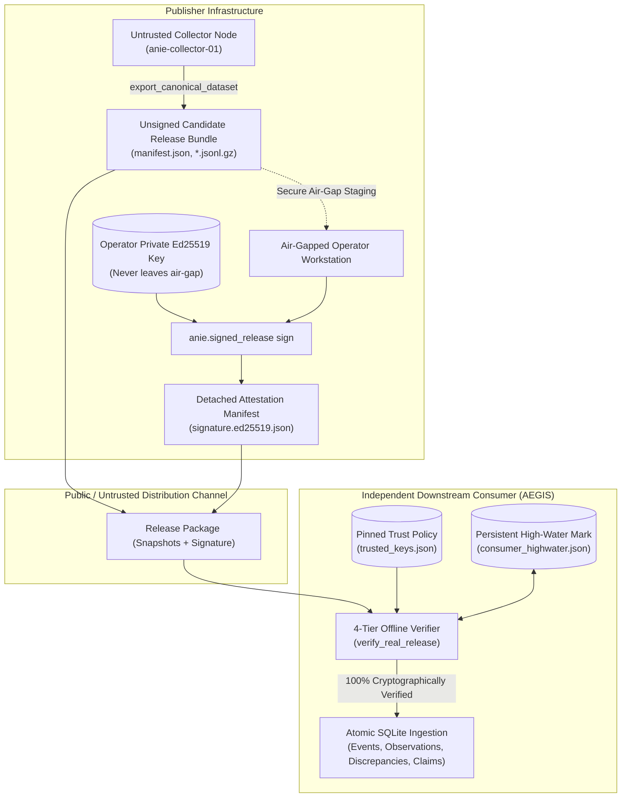
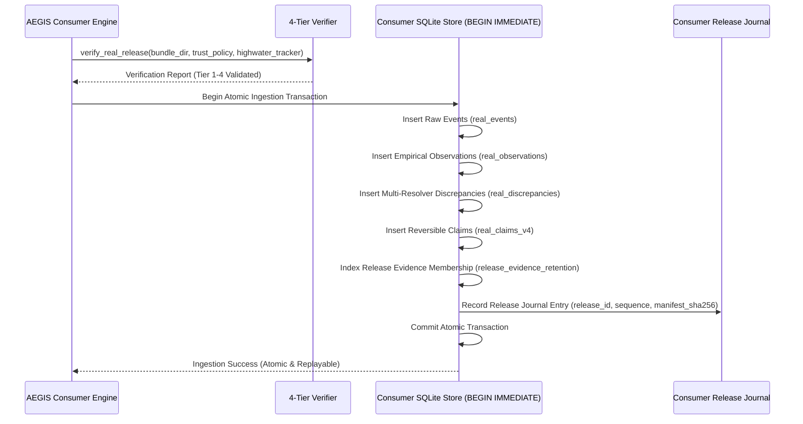

# ANIE Cryptographic Release Trust Architecture & Verification Protocol

**Project:** Autonomous Network Intelligence Engine (ANIE)  
**Document:** `docs/RELEASE_TRUST_DESIGN.md`  
**Accepted Baseline:** Milestone M3.8 (`6352bc6`)  
**Status:** Implemented, Formally Accepted & Verified

---

## 1. Architectural Philosophy & Threat Boundary

In decentralized internet intelligence distribution, a checksum downloaded from the same channel as a dataset **cannot authenticate its publisher**: an adversary compromising the distribution channel can replace both the payload and the checksum.

To establish genuine provenance and supply-chain integrity without introducing complex online infrastructure, ANIE implements a **detached, air-gapped cryptographic attestation model**:

### Core Trust Invariants
1. **Air-Gapped Private Keys:** Primary Ed25519 signing keys (`Ed25519PrivateKey`) **never reside on collector nodes or CI runners**. Cloud collectors only export candidate unsigned release bundles.
2. **Deterministic Reproducibility:** Data partitions are formatted in canonical JSON, strictly sorted (`observed_at ASC, id ASC`), and compressed with fixed gzip headers (`mtime=0`, empty filename, `compresslevel=9`).
3. **Detached Attestation:** Signatures are stored in a standalone attestation file (`signature.ed25519.json`) following the `anie.attestation.v1` schema, binding the manifest SHA-256 digest, publisher identity, Git commit SHA, and monotonic sequence counter.
4. **Offline Independent Verification:** Downstream consumers verify cryptographic signatures, wire digests, and sequence numbers with zero network callbacks.

---

## 2. Four-Tier Verification Hierarchy

The verification engine (`verify_real_release()`) evaluates candidate releases across four independent tiers:

| Tier | Name | Invariants Verified | Failure Mode |
| :---: | :--- | :--- | :--- |
| **Tier 1** | `structural_valid` | - Directory structure and file presence. - Manifest JSON schema compliance. - Compressed archive file size limits ($\le 100\text{ MiB}$). | `StructuralIntegrityError` |
| **Tier 2** | `evidence_integrity_valid` | - Record schema validation (`RealObservation`, `RealCollectionEvent`). - SHA-256 wire digest verification (`raw_sha256`). - Deterministic record sorting and non-empty IDs. - Complete referential integrity (zero orphan IDs). | `EvidenceIntegrityError` |
| **Tier 3** | `publisher_authenticated` | - Detached Ed25519 signature verified against pinned public keys. - Publisher string matches trust policy. - Git commit format and signing timestamp bounds validated. | `PublisherAuthenticationError` |
| **Tier 4** | `anti_rollback_verified` | - Monotonic sequence number $>$ stored high-water mark. - High-water mark updated atomically upon successful verification. - Explicit bypass only when `--allow-rollback` is supplied for historical audits. | `AntiRollbackError` |

---

## 3. Atomic Downstream Consumer Ingestion Protocol (AEGIS V4)

Downstream consumers (including the AEGIS framework) ingest verified releases through `RealObservationStore.ingest_release_bundle()` under strict transactional guarantees:

### Guarantees Enforced:
- **All-or-Nothing Atomicity:** If a crash or error occurs at any point during event, observation, discrepancy, or claim insertion, the entire transaction rolls back cleanly without leaving orphaned records.
- **Durable Evidence Retention:** `release_evidence_retention` establishes a durable index linking every retained signed release to its prerequisite observations. Evidence required to independently verify retained releases is protected against automated pruning.
- **Reversible Claim Assertions:** Every claim asserts specific lifecycle states (`ACTIVE`, `SUPERSEDED`, `REVOKED`) bound to the originating release ID, enabling surgical rollback if an upstream key or release is revoked.

---

## 4. Key Custody, Rotation & Rollback Lifecycle

1. **Air-Gapped Key Custody:**
   - Keys are generated and stored exclusively on secure, air-gapped workstations using encrypted PKCS#8 PEM encoding.
   - Operator workstations execute detached signing via `anie sign-release` without network connectivity.
2. **Dual-Key Rotation Policy:**
   - The consumer trust policy (`config/trusted_keys.json`) maintains a registry of authorized key IDs with explicit validity intervals.
   - During key rotation, the retiring key and new key overlap for at least two release cycles.
3. **Monotonic Sequence & Anti-Rollback:**
   - Releases carry a strictly increasing integer `sequence` counter.
   - Consumers store the latest accepted sequence in a concurrency-safe local state tracker (`consumer_highwater.json`).
   - Replay attacks presenting validly signed but older releases are rejected.
