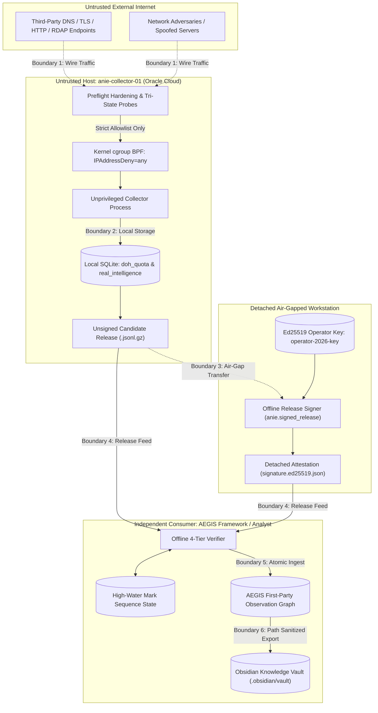

# ANIE Threat Model & Security Architecture

**Project:** Autonomous Network Intelligence Engine (ANIE)  
**Document:** `docs/THREAT_MODEL.md`  
**Accepted Baseline:** Milestone M3.8 (`6352bc6`)  
**Security Standard:** Defense-in-Depth & Epistemic Isolation

---

## 1. System Assets & Trust Boundaries

### Trust Boundary Definitions
- **Boundary 1 (External Internet $\to$ Collector):** Untrusted wire traffic from third-party authoritative resolvers, TLS endpoints, HTTP servers, and RDAP registries. Potential for DNS spoofing, server impersonation, HTTP header injection, and malformed wire formats.
- **Boundary 2 (Collector Runtime $\to$ Local Storage):** Untrusted cloud instance runtime. Potential for compute compromise, memory inspection, or storage corruption.
- **Boundary 3 (Collector $\to$ Air-Gapped Signer):** The boundary across which unsigned candidate release bundles are staged for cryptographic authentication. No private key ever crosses this boundary.
- **Boundary 4 (Release Distribution $\to$ Consumer Verifier):** Public/untrusted release distribution channel. Releases may be intercepted, modified, or replayed by malicious intermediaries.
- **Boundary 5 (Consumer Verifier $\to$ Internal Graph):** Downstream consumer data boundary. Protects internal investigation context, analyst databases, and case entities from being overwritten, corrupted, or exfiltrated.
- **Boundary 6 (Knowledge Graph $\to$ Filesystem / Obsidian Vault):** Knowledge rendering boundary. Protects the local filesystem from path traversal, arbitrary file overwrite, or markdown injection attacks.

---

## 2. Threat Analysis & Hardened Countermeasures

| Threat Vector | Description | Architectural Countermeasure | Verification Status |
| :--- | :--- | :--- | :--- |
| **SSRF & Egress Rebinding** | Malicious DNS responses or redirects attempting to route probes to internal or cloud services. | Tri-state preflight socket probing (`BLOCKED`, `ALLOWED`, `UNVERIFIABLE`), kernel cgroup BPF `IPAddressDeny=any`, single-socket pinned DoH IP without redirects. | **VERIFIED** (`test_preflight_hardening.py`, `test_doh_collector.py`) |
| **Cloud IMDS Exfiltration** | Attempts to query cloud metadata services (`169.254.169.254:80`) to steal instance tokens. | Host-level netfilter drop rules (`iptables`/`nftables`) verified fail-closed during preflight; cgroup BPF blocks all non-allowlisted egress. | **VERIFIED** (`test_preflight_hardening.py`) |
| **Decompression Bombs & Memory Exhaustion** | Maliciously compressed gzip bundles or massive HTTP headers designed to crash consumers. | Hard uncompressed partition ceiling ($\le 100\text{ MiB}$), per-record budget ($\le 500\text{ KiB}$), streaming line-by-line parsing, and bounded HTTP header counts ($\le 32$ headers, $\le 8\text{ KiB}$ total). | **VERIFIED** (`test_real_models.py`, `test_m3_8_http_enrichment.py`) |
| **DNS Spoofing & Resolver Bias** | Compromised or lying recursive DNS resolver poisoning observation records. | Multi-resolver discrepancy matrix querying three distinct providers (Cloudflare, Google, Quad9); explicit DNSSEC validation flags; wire-format SHA-256 digests. | **VERIFIED** (`test_multi_resolver_intelligence.py`) |
| **Technology Spoofing (HTTP)** | Attackers spoofing `Server` or `Via` headers to mislead reconnaissance or disguise infrastructure. | Technology headers classified strictly as **spoofable derived assertions** (`DERIVED`), never infrastructure facts (`FACT`); Competing Hypothesis Engine evaluates alternative explanations. | **VERIFIED** (`test_m3_8_http_enrichment.py`, `test_m3_8_competing_hypotheses.py`) |
| **Malicious Certificate Injection** | Offline injection of arbitrary TLS certificates into property graph. | `SERVES_CERTIFICATE` edges strictly require verified, live observed TLS handshake evidence (`source_observation_id`, endpoint, port, time); offline certificates remain disconnected from live infrastructure. | **VERIFIED** (`test_m3_7_correctness_and_hardening.py`) |
| **Path Traversal via Vault Export** | Adversary crafting entities with filenames containing `../` or `/` to overwrite host files during Obsidian export. | Canonical vault sanitizer (`sanitize_vault_filename`) strips `..`, `/`, `\`, null bytes, and control characters, restricting writes strictly inside the target vault directory. | **VERIFIED** (`test_m3_7_correctness_and_hardening.py`, `test_m3_8_knowledge_export_and_hardening.py`) |
| **Partial / Interrupted Ingestion** | Collector or consumer crash during release ingestion leaving orphaned records or inconsistent claims. | Complete transactional atomicity in SQLite (`BEGIN IMMEDIATE`): events, observations, discrepancies, claims, and journal commit atomically or roll back completely. | **VERIFIED** (`test_v4_claims_release.py`) |
| **Release Replay / Rollback** | Adversary replaying older signed releases to suppress newer security findings. | Anti-rollback high-water mark sequence tracker; release verification rejects sequence numbers $\le$ current high-water mark unless `--allow-rollback` is passed for historical audits. | **VERIFIED** (`test_signed_release.py`) |
| **Private Provenance Key Compromise** | Compromise of cloud VM or CI runner leading to unauthorized signed intelligence. | Primary Ed25519 private keys **never reside on collector nodes or CI runners**. Signing is performed exclusively on air-gapped operator workstations. | **VERIFIED** (`test_publication_trust_boundaries.py`) |

---

## 3. Epistemic Guardrails (Humility by Design)

- **Outlier $\neq$ Malicious:** Statistical distance or temporal drift is an indicator of change—**never a verdict of maliciousness, compromise, or threat**.
- **No Automated Enforcement:** ANIE outputs observable facts and hypothesis structures; downstream consumers (AEGIS) must never trigger automated network containment based on novelty scores alone.
- **Exclusion of Downstream Context:** ANIE operates in complete isolation from downstream investigation cases, target identities, and analyst workflows.
